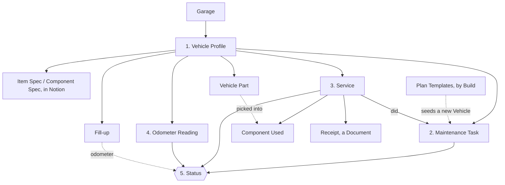
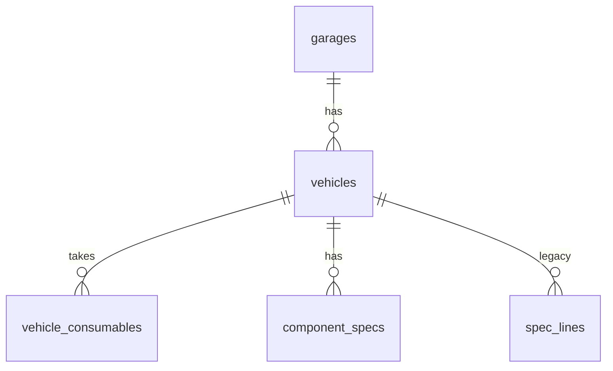
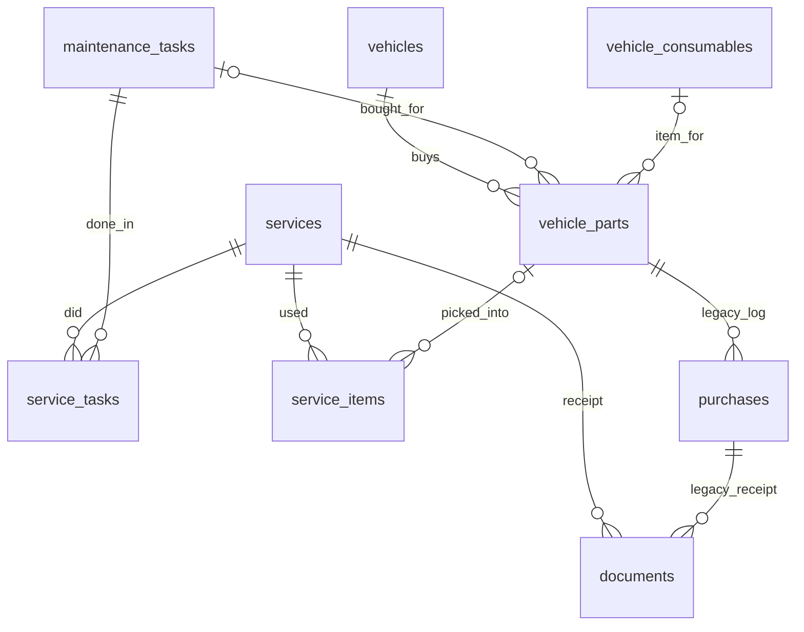

# Data model

What is stored, how it connects, and which rules protect it. Terms (Vehicle, Service, Spec Line…) are defined in [CONTEXT.md](../CONTEXT.md).

The code is the source of truth: [`db.ts`](../src/server/db.ts) (tables), [`types.ts`](../src/shared/types.ts) (what the app sees), [`catalogue.ts`](../src/shared/catalogue.ts) (built-in plan templates). If this page and the code disagree, fix this page.

Read the section you need: use the table of contents below, not the whole file.

| Section | Covers |
| --- | --- |
| [Overview](#overview) | The five parts, storage, conventions |
| [1. Vehicle Profile](#1-vehicle-profile) | `garages`, `vehicles`, `spec_lines` (legacy), `spec_line_moves` |
| [2. Maintenance Plan](#2-maintenance-plan) | `maintenance_tasks`, templates, `catalogue_parts` |
| [3. Service History Log](#3-service-history-log) | `services`, `service_tasks`, `service_items`, `vehicle_parts`, `purchases` (legacy), `documents` |
| [4. Mileage Log and fuel](#4-mileage-log-and-fuel) | `odometer_readings`, `fuel_fillups` |
| [5. Worked out, not stored](#5-worked-out-not-stored) | Odometer, consumption, Due Date, Status |
| [Notion referentials](#notion-referentials) | `ref_tasks`, types, `products`, `tools`, `vehicle_consumables`, `component_specs`, `ref_purchases` (Achats), `notion_state` |
| [Todoist](#todoist) · [Deleting](#deleting-things) · [Offline copy](#the-offline-copy) · [Changing the model](#changing-the-data-model) | |

## Overview

Five parts:

1. **Vehicle Profile**: the Vehicle (`vehicles`) and its specs: Item Specs and Component Specs, kept in Notion (`vehicle_consumables`, `component_specs`; see Notion referentials). The old Spec Lines (`spec_lines`) are frozen, read-only legacy (ADR 0009).
2. **Maintenance Plan**: the Vehicle's own Tasks (`maintenance_tasks`). A new Vehicle starts from the Plan Templates that fit its Build; after that the plan is the owner's.
3. **Service History Log**: Services (`services`) with Tasks done (`service_tasks`), components used (`service_items`, picked from the Vehicle's parts list `vehicle_parts`) and a receipt (`documents`).
4. **Mileage Log**: dated odometer values (`odometer_readings`, plus the odometer of each Service and Fill-up). Fill-ups (`fuel_fillups`) are the fuel log.
5. **Status**: never stored; worked out from the others.

**Where the data lives**, under `DATA_DIR` (never in git):

| What | Where |
| --- | --- |
| Database | `garage.sqlite`, one file with every table here ([ADR 0002](adr/0002-self-hosted-on-nas-with-sqlite.md)) |
| Document files | `uploads/<document id>` (the database holds only their details) |
| Backups | `backups/garage-v<version>-<time>.sqlite`, written before any schema update |

The built-in Plan Templates live in code, so a release can improve them. The phone holds an offline copy ([below](#the-offline-copy)).

**Conventions** (apply to every table, not repeated below):

- `id`: random UUID primary key unless stated. The server creates it, except for Services, Odometer Readings and Fill-ups: the phone creates theirs, so a write sent twice from the offline queue updates one record.
- `created_at`: UTC, filled by the database. `sort`: position within the parent.
- Dates are `YYYY-MM-DD` text, distances whole km, yes/no are 0/1, amounts plain numbers (no currency stored).
- Empty means unknown. **required** = the database refuses empty; **→ `table`** = points at a row of that table.

## 1. Vehicle Profile

### `garages`

`name` (required).

### `vehicles`

Never deleted: sold, hidden from the garage page, or both.

| Column | Meaning |
| --- | --- |
| `garage_id` | Required. → `garages`. |
| `kind` | Required. `car` or `motorcycle`. |
| `name` | Required. The owner's name for it. |
| `make`, `model`, `vin` | Brand, model, identification number. |
| `year` | Year of `first_registration_date`, not typed by hand. An older Vehicle keeps its year until a date is given. |
| `first_registration_date`, `purchase_date` | Optional dates: first on the road ("mise en circulation"); bought by the owner. |
| `ownership` | Required. `owned` (default) or `sold`. Sold keeps its history and has nothing due. Not the Status of section 5. |
| `sold_date`, `sold_odometer`, `sold_price` | Set when sold. |
| `on_garage_page` | Required. Has a card on the garage page, whatever its ownership. Selling hides it; the owner can change that. |
| `equipment` | Required, a JSON list of text (default `[]`). The equipment tags the owner picks in the Notion Véhicules database ("Transmission chaîne", "ABS"…). Written by the Notion pull only; it decides which catalogue tasks apply. |
| `notion_page_id` | The Vehicle's page in the Notion Véhicules database, for the link on its page. Written by the pull. |

Build columns decide which Plan Templates a new Vehicle gets:

| Column | Applies to | Values |
| --- | --- | --- |
| `fuel` | Both | `petrol`, `flexfuel`, `diesel`, `hybrid`, `phev`, `electric` (a motorcycle: `petrol` or `electric`) |
| `transmission` | Both | `manual`, `automatic`, `dct`, `cvt`, `e_cvt`, `single_speed` |
| `drivetrain` | Cars | `fwd`, `rwd`, `awd` |
| `distribution` | Cars | Timing drive: `belt`, `chain`, `none` (electric) |
| `final_drive` | Motorcycles | `chain`, `belt`, `shaft`, `gear`, `none` |
| `cooling` | Motorcycles | `liquid`, `air` |
| `cylinders` | Motorcycles | 1 or more |
| `has_hydraulic_clutch` | Motorcycles, manual | Required, yes/no |
| `has_turbo`, `has_direct_injection`, `has_start_stop`, `has_adblue`, `has_ac`, `has_air_suspension` | Cars | Each required, yes/no |

A new Vehicle must give its whole Build; the server refuses impossible combinations (a hybrid with a manual gearbox). Older Vehicles may have gaps; an empty fuel counts as combustion.

### `spec_lines` (frozen legacy)

**Frozen since ADR 0009**: no route adds, edits or deletes a Spec Line any more, and the usual-lines list (`spec-templates.ts`) is gone. The one-off move to Notion (`POST /api/notion/spec-migration`, dry run first) copies each line into an Item Spec or Component Spec page and records it in `spec_line_moves`. The snapshot's `specLines` carries only the lines **not moved** (or that cannot be, such as those of a sold Vehicle with no Notion page); the Specs page shows them read-only under "Old specs". Nothing is deleted. The rest of this section describes what the lines were.

Factory reference values for the workshop ("Engine oil: 10W-40, 3.2 L", "Drain plug: 30 Nm"). Tasks do not link to them; a Task names what it needs in its Notes. No dates, history or unit: the value is free text.

| Column | Meaning |
| --- | --- |
| `vehicle_id` | Required. → `vehicles`. |
| `label` | Required, ≤ 80 chars. Unique per Vehicle (a twin is refused, 409). |
| `value` | ≤ 200 chars, free text. Required when the owner saves, but empty on a line added from the usual list until filled ("to fill in"). |
| `oem` | Optional, ≤ 80 chars. Manufacturer reference, shown under the value. |
| `spec_group` | Required. `fluids`, `parts`, `torque` or `other`. |
| `category` | Same seven values as Tasks. Empty counts as `other`. |
| `template_code` | The usual line it came from (a list since removed), empty for the owner's own. Unique per Vehicle, so adding the usual lines again never doubles one, whatever it was renamed to. |
| `sort` | Required. Order within its group; a new line goes last; changing group moves it to the end of the new one. |

- **Add the usual specs** is gone (ADR 0009): the lines are not added, edited or deleted any more.
- Lines not moved travel in the offline snapshot for reading. A sold Vehicle keeps its lines. "Copy tasks from…" copies Tasks only.
- Lines migrated from the earlier Part Specs and Vehicle Specs got a category by matching label words; unmatched and every torque line show under Other.

### `spec_line_moves`

Which Spec Line went to which Notion page in the one-off move, so it never makes a page twice and can be traced back. Added by the ADR 0009 migration (additive only: the previous release still runs on this schema).

| Column | Meaning |
| --- | --- |
| `spec_line_id` | Primary key. → `spec_lines`. One move per line. |
| `target` | `item_spec` (fluids and parts) or `component_spec` (torque and other). |
| `notion_id` | The Notion page the line went to (or was linked to). |
| `created_page` | 1 when the move made the page, 0 when it linked to a page that was already there. |
| `moved_at` | When. |

## 2. Maintenance Plan

### `maintenance_tasks`

| Column | Meaning |
| --- | --- |
| `vehicle_id` | Required. → `vehicles`. |
| `name`, `name_fr` | Required (English); the French name shown in French. |
| `action` | Required. `replace`, `inspect`, `clean`, `adjust`. |
| `interval_km`, `interval_months` | At least one required: distance, time, or both (whichever comes first). |
| `baseline_date`, `baseline_odometer` | Last done before tracking. Any Service supersedes it. The odometer needs the date. |
| `category` | `engine`, `transmission`, `brakes`, `chassis`, `electrical`, `cooling_climate`, `other`. Empty = `other`. |
| `notes` | Instructions, torque values, part codes, links. |
| `switched_off` | Required, yes/no. Paused: no Due Date. |
| `template_code` | The Plan Template it came from, empty for the owner's own. Shown as a "Standard" badge. Unique per Vehicle. |
| `ref_task_id` | → `ref_tasks`. Set when the Task follows the Notion catalogue: its `name`, `name_fr`, `action`, intervals and `notes` are then Notion's (read-only in the app, 409 `notion_owned`); `switched_off` and the baseline stay the app's, and so does `category` unless the catalogue task has one (then each sync sets it). Unique per Vehicle. |
| `notion_plan_id` | The Notion Plan page behind a linked Task, empty until one exists. Unique. |
| `plan_auto` | Yes/no. 1 when the sync derived the Task (no Plan page yet), 0 for a Task made from a Plan page. |
| `notion_removed` | Reserved (0). A Task is never hidden or deleted by the sync. |

### Plan Templates

Built in [`catalogue.ts`](../src/shared/catalogue.ts) (listed in [plan-templates.md](plan-templates.md)): name in both languages, Action, Category, Interval, and the Build details it applies to; plus the owner's changes in `catalogue_parts`.

- Once the Notion catalogue has rows (`ref_tasks`), **the Templates stop seeding** new Vehicles, "Add missing tasks from templates" does nothing, and "Add the usual specs" does nothing: Notion decides.
- A **new Vehicle** gets the Templates that fit its Build, at the Template's Interval (shorter oil distance with a turbo).
- A Template can **include** another (`includes`): logging fork seals also logs fork oil; the oil can be done alone. The server adds the included Task when the Service is saved.
- After creation the Tasks are the Vehicle's own; changing a Template or the Build never changes them.
- **Add missing tasks from templates** gives an existing Vehicle the Templates it lacks. A Task is the Template's if it carries the `template_code` or, for older or hand-made Tasks, is named like the Template or its part (it is then tagged). Safe to run again. **Merging** a duplicate Task moves its Services over and passes on its `template_code`.
- **Settings** edits any Template (name, Action, Category, Interval, Build details); a built-in one can be taken off the list or reset.

### `catalogue_parts`

Key: `garage_id` + `code` (no `id`). `unit` and `characteristics` are unused.

| Column | Meaning |
| --- | --- |
| `garage_id` | Required. → `garages`. |
| `code` | Required. A built-in code, or `own_<uuid>` for an own Template. |
| `kind` | `car` or `motorcycle`. **Empty = the row changes a built-in Template**; filled = a whole own Template. |
| `name`, `name_fr`, `category`, `action` | An own Template's values; for a built-in one, the owner's override (empty keeps the built-in). |
| `interval_km`, `interval_months` | Default Interval: always for an own Template, for a built-in one only when `interval_set` is 1. |
| `interval_set` | Required, yes/no. |
| `conditions` | JSON: allowed values per Build detail, e.g. `{"fuel":["diesel"],"hasTurbo":["true"]}` = diesel with turbo only. Unlisted details don't matter. Empty keeps the built-in conditions. |
| `removed` | Required, yes/no. Built-in Template taken off the list. |

## 3. Service History Log

### `services`

| Column | Meaning |
| --- | --- |
| `vehicle_id` | Required. → `vehicles`. |
| `date` | Required. |
| `odometer` | Required only when a Task done counts distance. |
| `kind` | Required. `maintenance` (default, did plan Tasks) or `repair` (outside the plan). |
| `title` | Repair title ("New starter motor"). Required for a repair. |
| `category` | A repair's category (Task values). Empty = `other`. |
| `performed_by` | Required. `diy` (default), `garage`, `dealership`. |
| `total_cost`, `notes` | Parts and labour in one amount; free text. |

A maintenance Service did at least one Task; a repair needs a title and may have none. Logging a Service restarts the count of each Task it did. Services can be edited.

### `service_tasks`

Tasks done in a Service. Key: `service_id` + `task_id`, both required (→ `services`, → `maintenance_tasks`).

### `service_items`

Components used. Key: `service_id` + `sort`.

| Column | Meaning |
| --- | --- |
| `service_id` | Required. → `services`. |
| `description` | Required. Brand and variant. |
| `part_number` | |
| `quantity`, `unit` | Required. Unit `piece` or `litre`. |
| `price` | Paid per piece or litre, when known. |
| `part_id` | → `vehicle_parts`, where it was picked from. Loose: emptied if the part is deleted. The component keeps its own copy of description, part number, quantity, unit and price, so history never changes. |

### `vehicle_parts`

The Vehicle's **parts list**: what is actually bought ("Motul 7100 10W-40"), unlike an Item Spec, the factory reference. The Service form picks from it and fills description, part number, unit, usual quantity and price.

| Column | Meaning |
| --- | --- |
| `vehicle_id` | Required. → `vehicles`. |
| `name` | Required, ≤ 200 chars. With part number, unique per Vehicle ignoring case and accents (a twin is refused, 409). |
| `part_number` | |
| `unit`, `quantity` | Required. `piece`/`litre`; the usual quantity per Service. |
| `price` | Per piece or litre. Changed by hand only; a Service never changes it. |
| `task_id` | → `maintenance_tasks`, the Task it is usually bought for (its parts are listed first when ticked). Emptied if the Task is deleted; moves to the kept Task on merge. |
| `item_spec_id` | → `vehicle_consumables` (the **Item Spec**) of the same Vehicle that Notion still has (else 422, `That item spec is not on this vehicle`); shown as "Spec: …", nothing copied or synced. Loose, a plain column. On edit, omitted keeps it; null removes it. Re-pointed by the one-off move for the items that had a Spec Line. |
| `spec_line_id` | **Legacy**, read-only: the Spec Line it was for, shown only while that line is not moved. Never written any more; an old app's `specLineId` is stripped. |
| `to_buy` | Legacy column, no longer read or written since 2026-11-10 ([ADR 0008](adr/0008-shopping-list-and-purchase-log-move-to-notion.md)); kept so a rollback works; may be dropped later (`ALTER TABLE vehicle_parts DROP COLUMN to_buy`). New rows get the default 0. |
| `notes` | Free text; links are tappable. |

- **Parts section** (all Vehicles; filter by Vehicle, search box): list, add, edit, delete; read-only offline. The list travels in the snapshot for reading and for the Service form. A Vehicle page opens it filtered.
- **From a Service**: a typed component is also kept in the list unless "Keep in the parts list" is unticked. The phone makes the part id and sends it with the Service, so a resend never doubles it (works offline too). A matching name and part number links instead of adding a twin. A Service with exactly one Task ties the new part to it. The Service form lists the parts for the ticked Tasks first, then the others.
- Editing the description or part number of a picked component detaches it from the list part.

### `purchases` (legacy)

**Legacy, unused** since 2026-11-10 ([ADR 0008](adr/0008-shopping-list-and-purchase-log-move-to-notion.md)): the app no longer reads or writes it, there is no route for it and the snapshot does not carry it. The table and its rows are kept so a rollback works. What was bought now comes from the owner's Notion Achats (see `ref_purchases`).

| Column | Meaning |
| --- | --- |
| `part_id` | Required. → `vehicle_parts`. Deleting the part still deletes these rows (foreign key cascade); their receipt Documents and files stay stored, unreachable. |
| `vehicle_id` | Required. → `vehicles`, kept for scoping and export. |
| `date`, `quantity` | Required. Quantity in the part's unit. |
| `total_paid` | Required. Goods only, as on the receipt, never delivery. Price per unit worked out, never stored. |
| `shop`, `notes` | Optional. |
| `delivery_fees` | Optional. Separate, never inside `total_paid`. |

A legacy Purchase's receipt is a Document with `owner_kind` `purchase`; the `documents` check still allows it, and a new one is refused (422).

### `documents`

**Receipts are added and removed on the desktop only (ADR 0009); the phone shows them read-only. They never go to Notion.** The server still accepts an upload from any client: the rule is in the screens.

Belongs to one owner (`owner_kind` + `owner_id`). Shown only for a Service and a Vehicle. Documents of removed features (insurance, inspections, legacy purchase receipts) stay stored, unshown. The server checks the owner exists and removes a Service's Documents, files included, with it.

| Column | Meaning |
| --- | --- |
| `garage_id` | Required. → `garages`. |
| `vehicle_id` | → `vehicles`. |
| `owner_kind` | Required. `service` or `vehicle` for new rows (`purchase`: legacy, unused; older rows may differ). |
| `owner_id` | Required. |
| `type` | Required. `invoice` for a receipt. |
| `file_name`, `content_type`, `size` | Required. Original name, e.g. `application/pdf`, bytes. |
| `title`, `issue_date`, `expiry_date` | Unused for receipts. |

## 4. Mileage Log and fuel

### `odometer_readings`

`vehicle_id` (required, → `vehicles`), `date` (required), `odometer` (required).

A Vehicle's Mileage Log is its readings plus the odometer of its Services and Fill-ups (when present).

### `fuel_fillups`

One row per visit to the pump. Consumption is worked out from it, never stored. Electric Vehicles do not show it.

| Column | Meaning |
| --- | --- |
| `vehicle_id` | Required. → `vehicles`. |
| `date` | Required. |
| `odometer` | Optional. Without it a Fill-up gives no distance and breaks the chain of full tanks. |
| `litres` | Required. |
| `total_paid` | Required. Whole fill-up. Price per litre worked out, never stored. |
| `full_tank` | Required. 1 full, 0 top-up. |
| `notes` | Optional. |

Limits catching a slipped decimal point (litres 0.5–200, price per litre 0.2–10, total ≤ 2000) are in [`fuel.ts`](../src/shared/fuel.ts), used by server and form. Non-blocking odometer and duplicate-Service checks are in [`consistency.ts`](../src/shared/consistency.ts) (forms only, no server rule).

## 5. Worked out, not stored

Always calculated, so they can't drift from the history. Code in [`src/shared`](../src/shared).

| Value | How |
| --- | --- |
| Current odometer | Latest value logged in a reading, Service or Fill-up. Never estimated. |
| Consumption | Per full-tank Fill-up with an odometer: litres since the previous full tank with an odometer (its own plus the top-ups between) over the distance, in L/100 km. A full tank without an odometer breaks the chain (the next starts a new stretch). Equal or lower distance gives nothing. |
| Average consumption | All litres of the stretches over all their km (distance-weighted), not the mean of ratios. |
| Daily distance | Rate between logged values: last 180 days where possible, at least 14 days of history. |
| Due Date | From the last Service (or baseline): time Interval added to its date, distance Interval added to its odometer and projected to a date with the daily distance. The earlier of the two. A date from a distance is a projection, marked "≈". |
| Status | `overdue` when either Interval is used up; `dueSoon` at 10% or less of either left; `ok` otherwise; `unknown` if never done; `paused` if switched off. A Fill-up never changes a Status. |

## Notion referentials

Owned by Notion ([ADR 0007](adr/0007-two-way-notion-sync.md)): the server pulls them from the owner's hand-made databases and the app only reads them (the phone gets them in the snapshot, read-only). Two tables are also **written from the page Notion returns after a desktop edit** ([ADR 0009](adr/0009-specs-in-both-places-phone-for-logging.md)): `vehicle_consumables` and `component_specs`. The edit goes to Notion first, under the sync's lock, and the local row is saved only from Notion's answer; nothing is applied locally first, and there is no offline edit. Every table has `garage_id` (→ `garages`), `notion_id` (the Notion page; unique per garage, or per Vehicle for the two per-vehicle tables) and `notion_removed` (1 once the page left Notion: the row is hidden from the snapshot, never deleted, and shown again if the page returns). Relations between them hold the app's ids as a JSON list or a plain id, loose, without cascading keys.

| Table | Holds |
| --- | --- |
| `ref_tasks` | The task catalogue: `name`, `action` (`inspect`/`replace`/`clean`/`adjust`: Contrôle, Remplacement, Nettoyage, Réglage), `applicable_if` (equipment tags, all required; empty = every Vehicle), `default_km`, `default_months`, `consumable_type_ids`, `component_type_ids`, `tool_ids`, `instructions` (plain text), `category` (from Notion's "Catégorie": the app's French labels, plus Freins, Roues, Électrique; null when empty or unknown). |
| `ref_component_types` | `name`, `category`, `notes`. |
| `consumable_types` | `name`, `category`, `family` (`fluid`/`part`), `notes`. |
| `products` | `type_id`, `name`, `brand`, `reference`, `supplier`, `price` (a default, not a purchase), `notes`. |
| `tools` | `name`, `kind`, `size`, `owned`, `price`, `notes`. |
| `vehicle_consumables` | The **Item Specs** (the table keeps its old name so a rollback works), per Vehicle (`vehicle_id`): `name`, `type_id`, `specification`, `oem_ref`, `capacity`, `quantity`, `compatible_product_ids`, `chosen_product_id`, `confirmation` (`confirmed`/`to_confirm`/null). |
| `component_specs` | The **Component Specs**, per Vehicle: `label`, `component_type_id`, `category`, `value` (number or text), `unit`, `source`, `confirmation` (`confirmed`/`to_confirm`/null). Not the old `spec_lines`, which are frozen legacy. A Notion page pointing at several Vehicles gives one row each. |
| `ref_purchases` | The owner's **Achats** database, read-only ([ADR 0008](adr/0008-shopping-list-and-purchase-log-move-to-notion.md)): `date`, `article_notion_id` (the Notion page id of an Item Spec line, "Spécifications d'articles" (formerly "Consommables par véhicule"), matched to `vehicle_consumables.notion_id` when read, so the pull order does not matter), `product_id` (→ `products`, loose), `quantity`, `price`, `shop`. Never invoice files or notes. Not per Vehicle. Rows that left Notion are hidden. |
| `notion_state` | One row per garage: `last_sync_at`, `last_error`, `warnings` (JSON list), `paused_tasks`. Shown in Settings. |

`service_items` also has `consumable_type_id` and `product_id` (loose, set when a Service sends them), and `vehicle_parts` has `product_id` (loose).

**Bought or To buy** (worked out, never stored; [`purchases.ts`](../src/shared/purchases.ts), snapshot field `notionPurchases`): a required consumable is Bought when an Achat of one of the Vehicle's lines of that type is dated strictly after the Task was last done, otherwise To buy.
With several Tasks the latest last-done date applies; a type the Vehicle has no line for is not tracked, so nothing is shown.

**What the pull does** (one transaction; any error changes nothing): copies the tables above by `notion_id`; sets each Vehicle's `equipment`; then for each owned Vehicle, creates a Task for every applicable catalogue task that has no Task yet (`plan_auto = 1`), honours explicit Plan pages (`plan_auto = 0`, the Plan's interval overrides the default), and adopts an unlinked Task with the same normalised name instead of duplicating it (Notion's interval replaces the app's only where Notion has a value). A Plan page that vanishes, or a Task that stops applying, unlinks the Task and pauses it: never deleted, history kept. A table is cleaned only from a complete read, and not when Notion returned no rows or when more than the larger of 3 and half of the linked rows would go.

## Todoist

### `todoist_tasks`

The Todoist task made for a Task that became Due soon or Overdue, kept so its date can be updated and it can be completed. Server only: never in the offline copy. Key: `garage_id` + `key`.

| Column | Meaning |
| --- | --- |
| `garage_id` | Required. → `garages`. |
| `key` | Required. One occurrence: a Task since it was last done. Doing the job starts a new key. |
| `todoist_id` | Required. The id in Todoist. |
| `due_date` | Required. Last date sent. |

## Deleting things

Foreign keys block deletion while rows still need it, except below; the server adds rules.

| Deleting | What happens |
| --- | --- |
| Vehicle | Not possible: sell or hide it. |
| Maintenance Task | Refused if a Service used it; otherwise goes. Refused too (409 `notion_owned`) when it follows the Notion catalogue: it is paused or unlinked by the sync instead. |
| Notion referential row | Never deleted by the app: hidden (`notion_removed`) when its page leaves Notion. |
| Service | Its Task links, components and Documents go too. |
| Item Spec or Component Spec | Goes to the Notion trash, or this Vehicle is detached when the page covers several; the local row is hidden (`notion_removed`). Written to Notion first. |
| Spec Line | No longer deletable (frozen legacy). |
| Vehicle Part | Goes (with any legacy purchase rows; their receipt files stay stored, unreachable); past components keep their copy, lose the link. |
| Fill-up | Goes; nothing depends on it, consumption is recalculated. |
| Owner's Plan Template | Goes; Vehicles keep their Tasks. |
| Built-in Plan Template | Can't be deleted: take it off the list or reset it. |

## The offline copy

The phone keeps one `Snapshot` ([`types.ts`](../src/shared/types.ts)) to work with no signal ([ADR 0001](adr/0001-offline-service-logging-via-send-queue.md)).

- It holds Vehicles (with their equipment), Tasks, Services, readings, Fill-ups, the Spec Lines not moved to Notion, parts lists and Template changes; Document details but not files. It also holds the Notion referentials (catalogue, types, products, tools, per-Vehicle Item Specs (`itemSpecs`) and Component Specs (`componentSpecs`), and the Achats as `notionPurchases`) and the last sync status, **read-only**: they need no send queue.
- It is shaped for screens, not tables (a Service carries `taskIds` and `partsUsed`).
- Services, Odometer Readings and Fill-ups can be logged offline: queued on the phone, sent on reconnect. Everything else needs a connection.
- `normalizeSnapshot` in [`workshop.ts`](../src/shared/workshop.ts) fills what an older saved snapshot lacks (e.g. no Fill-ups) and drops removed fields.
- **Old names**: the Component Specs used to be `vehicleSpecs` and `vehicles.ownership`, `vehicleConsumables[].confirmation` and `componentSpecs[].confirmation` were all `status`. `normalizeSnapshot` maps the old names to the new ones, so a phone that saved a snapshot (or an old server answer) before the rename still loads. Keep that mapping while phones may hold old snapshots. `API_VERSION` went to 2 with the rename.
- **Item Specs** (ADR 0009): `itemSpecs` was `vehicleConsumables`; `normalizeSnapshot` maps the old key. `vehicleParts[].itemSpecId` is new, `specLines` holds only the lines not moved to Notion, and `API_VERSION` went to 3.
- The previous table and column names (`vehicle_specs`, `status` on `vehicles`, `vehicle_consumables` and the specs) live on only in backups written before the rename migration (`garage-v<N>-*.sqlite`).

## History: the five-parts rework

Ran once, after a backup, in [`five-parts.ts`](../src/server/five-parts.ts); nothing entered was lost. Insurance, Quotes, Technical Inspections and Modifications were removed with their tables (Documents stay stored, unshown). Part Specs and Vehicle Specs became Spec Lines. Required Parts, Tools and Workshop Notes went into Task Notes. Official Intervals folded into the stricter Interval. Parts Used became Components Used (supplier into the description, prices summed into the Service's total cost). Every logged Service became `diy`. Shopping List was removed. Vehicle registration, version, fiscal power, national type and parking columns were dropped (VIN stays; first registration and purchase dates came back as plain optional dates).

## Changing the data model

1. **Add a migration** at the end of `MIGRATIONS` in [`db.ts`](../src/server/db.ts). Never edit a shipped one. The server applies the rest at startup, each in a transaction, after a backup.
2. **Update the chain**: `types.ts`, `schemas.ts`, `app.ts`, and `normalizeSnapshot` for new snapshot fields.
3. **Add a migration test** starting from the version just before.
4. **Update this page**, and [CONTEXT.md](../CONTEXT.md) if a term changed.
5. **Keep it fake**: this repository is public (see [CLAUDE.md](../CLAUDE.md)).
