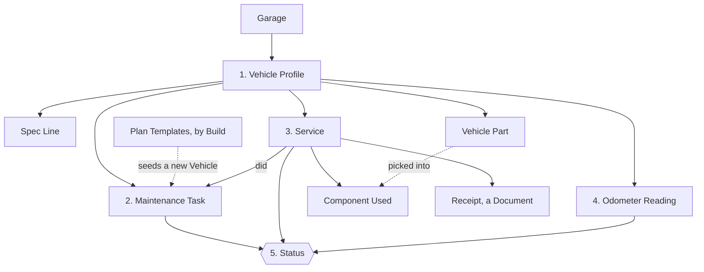
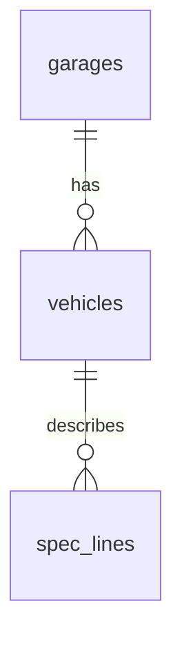
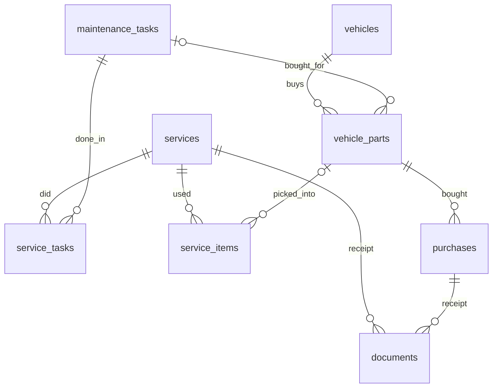

# Data model

How TMY Garage's data is organised: what is stored, how the pieces connect, and which rules protect them. The words used here (Vehicle, Service, Spec Line…) are defined in [CONTEXT.md](../CONTEXT.md).

The source of truth is the code: [`src/server/db.ts`](../src/server/db.ts) for the tables, [`src/shared/types.ts`](../src/shared/types.ts) for how the app sees them, and [`src/shared/catalogue.ts`](../src/shared/catalogue.ts) for the built-in plan templates. If this page and the code disagree, the code is right and this page needs fixing.

## The short version

The app rests on five parts.

1. **Vehicle Profile**: who the Vehicle is (`vehicles`) and its factory specs, a simple list of labelled values (`spec_lines`).
2. **Maintenance Plan**: the Vehicle's own Tasks (`maintenance_tasks`), each with an Action, an Interval, a Category and Notes. A new Vehicle starts from the **Plan Templates** that fit its Build; after that the plan is the owner's.
3. **Service History Log**: Services (`services`) with who did the work, the total cost, the Tasks done (`service_tasks`), the components used (`service_items`, picked from the Vehicle's parts list `vehicle_parts`) and a receipt (`documents`).
4. **Mileage Log**: dated odometer values (`odometer_readings`, and each Service's own).
5. **Status**: never stored. It is worked out from the other four (see [Worked out, not stored](#worked-out-not-stored)).

## Where the data lives

Everything below sits in the folder set by the `DATA_DIR` environment variable. None of it goes in git.

| What | Where | Notes |
| --- | --- | --- |
| The database | `garage.sqlite` | One SQLite file holding every table on this page (see [ADR 0002](adr/0002-self-hosted-on-nas-with-sqlite.md)). |
| Document files | `uploads/<document id>` | The database only holds their details. |
| Automatic backups | `backups/garage-v<version>-<time>.sqlite` | Written before any schema update of an existing database. |
| Push notification keys | `push-keys.json` | The server's own keys for sending Reminders. |

Two more places hold data:

- **The code** holds the built-in Plan Templates. They are not in the database, so a new release can improve them. See [Plan Templates](#plan-templates).
- **The phone** holds an offline copy. See [The offline copy](#the-offline-copy).

## Conventions

These apply to every table, and the tables below don't repeat them.

- **`id`** is the primary key, a random UUID, unless the table says otherwise. The server creates it, except for Services and Odometer Readings: the phone creates theirs, so that a write sent twice from the offline queue updates one record instead of making two.
- **`created_at`** is when the row was added, in UTC, filled in by the database.
- **`sort`** is a line's position within its parent.
- **Dates** are text in `YYYY-MM-DD` form. **Distances** are whole kilometres.
- **Yes/no values** are stored as 0 or 1.
- **Amounts** are plain numbers. No currency is stored.
- **Empty means unknown.** A column is required only where the tables below say so.

In the column tables, **required** means the database refuses an empty value, and **→ `table`** means the column points at a row of that table.

## 1. Vehicle Profile

### `garages`

| Column | Meaning |
| --- | --- |
| `name` | Required. |

### `vehicles`

A Vehicle is never deleted from the database. It is sold, hidden from the garage page, or both.

| Column | Meaning |
| --- | --- |
| `garage_id` | Required. → `garages`. |
| `kind` | Required. `car` or `motorcycle`. |
| `name` | Required. The owner's name for it. |
| `make` | Brand. |
| `model` | Model. |
| `year` | Year, always the year of `first_registration_date`; it is not typed by hand any more. A Vehicle created before that keeps the year it had until a date is given. |
| `vin` | Vehicle identification number. |
| `first_registration_date` | Optional date (`YYYY-MM-DD`): when the Vehicle first went on the road (the "date de mise en circulation"). |
| `purchase_date` | Optional date (`YYYY-MM-DD`): when the owner bought it. |
| `status` | Required. `owned` or `sold`, `owned` by default. A sold Vehicle keeps its history and has nothing due. |
| `sold_date` | Set when sold. |
| `sold_odometer` | Set when sold. |
| `sold_price` | Set when sold. |
| `on_garage_page` | Required. Whether it has a card on the garage page, whatever its status. Selling hides it, and the owner can change that. |

The Build columns decide which Plan Templates a new Vehicle gets:

| Column | Applies to | Values |
| --- | --- | --- |
| `fuel` | Both | `petrol`, `flexfuel`, `diesel`, `hybrid`, `phev`, `electric`. A motorcycle is only `petrol` or `electric`. |
| `transmission` | Both | `manual`, `automatic`, `dct`, `cvt`, `e_cvt`, `single_speed`. |
| `drivetrain` | Cars | `fwd`, `rwd`, `awd`. |
| `distribution` | Cars | The timing drive: `belt`, `chain`, or `none` on an electric car. |
| `final_drive` | Motorcycles | `chain`, `belt`, `shaft`, `gear`, `none`. |
| `cooling` | Motorcycles | `liquid`, `air`. |
| `cylinders` | Motorcycles | 1 or more. |
| `has_hydraulic_clutch` | Motorcycles with a manual gearbox | Required, yes/no. |
| `has_turbo` | Cars | Required, yes/no. |
| `has_direct_injection` | Cars | Required, yes/no. |
| `has_start_stop` | Cars | Required, yes/no. |
| `has_adblue` | Cars | Required, yes/no. |
| `has_ac` | Cars | Required, yes/no. |
| `has_air_suspension` | Cars | Required, yes/no. |

A new Vehicle must give its whole Build, and the server refuses impossible combinations (a hybrid with a manual gearbox, for example). A Vehicle added before this rule may still have gaps; an empty fuel counts as a combustion engine.

### `spec_lines`

A Vehicle's factory specs, one labelled value per row (for example "Engine oil: 10W-40, 3.2 L", "Front tyre: 120/70 ZR17, 2.5 bar", "Drain plug: 30 Nm"). They are reference data for the owner at the workshop: Tasks do not link to them, and a Task names what it needs in its Notes. A spec line has no dates, history or unit of its own; the value is free text.

| Column | Meaning |
| --- | --- |
| `vehicle_id` | Required. → `vehicles`. |
| `label` | Required, up to 80 characters. What it is. Unique per Vehicle: saving a second line with the same label is refused (409). |
| `value` | The figure or reference, written as the owner likes ("10W-40, 3.2 L"), up to 200 characters. Required when the owner saves a line, but empty on a line added from the usual list until they fill it in (shown as "to fill in"). |
| `oem` | Optional, up to 80 characters. The manufacturer's (OEM) reference, kept apart from the value and shown under it. |
| `spec_group` | Required. What kind of figure it is: `fluids`, `parts`, `torque` or `other`. |
| `category` | Which part of the Vehicle it concerns: the same seven categories as Tasks (`engine`, `transmission`, `brakes`, `chassis`, `electrical`, `cooling_climate`, `other`). Empty counts as `other`. |
| `template_code` | The usual spec line (see `src/shared/spec-templates.ts`) it came from, empty for the owner's own lines. Unique per Vehicle, so adding the usual lines again never doubles one, whatever it was renamed to. |
| `sort` | Required. Position within its group, in the order entered. A new line goes last in its group; changing a line's group moves it to the end of the new one. |

**Add the usual specs** (button on the Specs page) gives a Vehicle the usual lines for its Build, with empty values for the owner to fill in: fluids (engine oil, gearbox oil, coolant, brake fluid…), parts (tyres, filters, spark plugs, pads, battery…), torque (wheel nuts, drain plug, axle nuts) and a few others (chain slack). Which lines apply follows the Build like the plan templates (a diesel has a fuel filter, a belt-driven engine a timing belt kit, a chain drive a chain and sprockets). Labels are written in the language the app is in. A line already there is left alone: one with the template's code, or one labelled like it (which is then tagged). It is safe to run again. The list is built in code, not editable in Settings.

How the screens use them:
- The Specs page lists a Vehicle's lines under their **category** headings (in the same order as the Task list), and inside a category by **group** (fluids, parts, torque, other), then by `sort`. The group is shown next to each value.
- Adding, editing and deleting a line needs a connection to the server, like the other desk work; the lines travel in the offline snapshot so they can be read in the garage.
- A Vehicle keeps its lines when it is sold. "Copy tasks from…" copies Tasks only, never spec lines.

History: spec lines replaced the earlier Part Specs and Vehicle Specs (see the migration table below). Lines migrated from those were given a category by matching words in the label ("brake", "huile", "tyre"…); anything unmatched, and every torque line, has none and shows under Other.

## 2. Maintenance Plan

### `maintenance_tasks`

| Column | Meaning |
| --- | --- |
| `vehicle_id` | Required. → `vehicles`. |
| `name` | Required. Names the job, in English. |
| `name_fr` | The French name, shown instead in French. |
| `action` | Required. `replace`, `inspect`, `clean` or `adjust`. |
| `interval_km` | Distance Interval. |
| `interval_months` | Time Interval. At least one of the two is required: a distance only, a time only, or both (whichever comes first). |
| `baseline_date` | When it was last done before the garage tracked it. Any Service supersedes it. |
| `baseline_odometer` | The odometer at that time. Needs a baseline date. |
| `category` | `engine`, `transmission`, `brakes`, `chassis`, `electrical`, `cooling_climate` or `other`. Empty means `other`. |
| `notes` | Instructions, torque values, fluid reminders, standard part codes, links. |
| `switched_off` | Required, yes/no. Paused on this Vehicle: no Due Date, no Reminder. |
| `template_code` | The Plan Template (part code) the Task came from, empty for the owner's own Tasks. Shown as a "Standard" badge on the Vehicle page and the Task form. Unique per Vehicle, so adding templates again never doubles a Task, whatever it was renamed to. |

### Plan Templates

The Templates are the built-in list in [`catalogue.ts`](../src/shared/catalogue.ts) (listed in [plan-templates.md](plan-templates.md)) (name in both languages, Action, Category, Interval, and the Build details it applies to), plus the owner's changes in `catalogue_parts`.

- A **new Vehicle** gets the Templates that fit its Build as Tasks, at the Template's Interval (shorter engine oil distance with a turbo).
- A Template can **include** another (`includes` in the catalogue): logging a Service for the fork seals also logs the fork oil, since the seals are never done without it, while the oil can be done alone. The server adds the included Task to the Service when it is saved.
- After that the Vehicle's Tasks are its own. Changing a Template, or the Vehicle's Build, never changes them.
- **Add missing tasks from templates** (on the Vehicle page) gives an existing Vehicle the Templates it has no Task for yet. A Task is the Template's when it carries its `template_code`, or, for Tasks made before the code existed or by hand, when it is named like the Template or its part ("Engine oil"); such a Task is then tagged. It is safe to run again. **Merging** a duplicate into another Task (Task page) moves its Services over and passes its `template_code` on.
- **Settings** edits any Template: its name, Action, Category, Interval and the Build details it applies to; a built-in one can also be taken off the list or set back to the built-in version.

### `catalogue_parts`

The key is `garage_id` and `code`. This table has no `id`. The columns `unit` and `characteristics` are no longer used.

| Column | Meaning |
| --- | --- |
| `garage_id` | Required. → `garages`. |
| `code` | Required. A built-in code, or `own_<uuid>` for the owner's own Template. |
| `kind` | `car` or `motorcycle`. **Empty means the row changes a built-in Template**, and filled means it is a whole Template of the owner's. |
| `name`, `name_fr` | An own Template's name; for a built-in one, the owner's own task name (empty keeps the built-in one). |
| `category` | The same: an own Template's, or the owner's choice for a built-in one. |
| `action` | The same. A built-in Template's Action otherwise comes from its name. |
| `interval_km`, `interval_months` | The default Interval: for an own Template always, for a built-in one only when `interval_set` is 1. |
| `interval_set` | Required, yes/no. A built-in Template whose default Interval is the owner's. |
| `conditions` | JSON: for each detail of the Build, the values allowed. Empty keeps a built-in Template's own conditions. |
| `removed` | Required, yes/no. A built-in Template taken off the list. |

For example, conditions of `{"fuel":["diesel"],"hasTurbo":["true"]}` mean a Vehicle gets the Template only if it runs on diesel and has a turbo. A detail that isn't listed doesn't matter.

## 3. Service History Log

### `services`

| Column | Meaning |
| --- | --- |
| `vehicle_id` | Required. → `vehicles`. |
| `date` | Required. |
| `odometer` | Required only when a Task done counts distance; time-based Tasks alone may leave it out. |
| `kind` | Required. `maintenance` (it did Tasks of the plan) or `repair` (outside the plan). `maintenance` by default. |
| `title` | A repair's title, such as "New starter motor". Required for a repair, empty for maintenance. |
| `category` | A repair's category, same values as a Task's. Empty means `other`. |
| `performed_by` | Required. `diy`, `garage` (independent garage) or `dealership`. `diy` by default. |
| `total_cost` | Parts and labour in one amount. |
| `notes` | Free text. |

A maintenance Service did at least one Task; a repair needs a title and may have none. Logging a Service restarts the count of each Task it did. A logged Service can be edited.

### `service_tasks`

The Tasks done in a Service. The key is `service_id` and `task_id`.

| Column | Meaning |
| --- | --- |
| `service_id` | Required. → `services`. |
| `task_id` | Required. → `maintenance_tasks`. |

### `service_items`

The components used in a Service. The key is `service_id` and `sort`.

| Column | Meaning |
| --- | --- |
| `service_id` | Required. → `services`. |
| `description` | Required. Brand and variant, such as "Motul 7100 10W-40". |
| `part_number` | |
| `quantity` | Required. |
| `unit` | Required. `piece` or `litre`. |
| `price` | What was paid per piece or per litre, when known. |
| `part_id` | → `vehicle_parts`, the Vehicle Part it was picked from. Loose: it is emptied if that part is deleted, and the component keeps its own copy of the description, part number, quantity, unit and price, so history never changes. |

### `vehicle_parts`

The parts and fluids bought for one Vehicle: the **parts list**. When logging a Service, the owner picks from it instead of typing, and the form fills in the description, part number, unit, usual quantity and price. It is the list of what is actually bought ("Motul 7100 10W-40"), unlike a Spec Line, which is the factory reference ("Engine oil: 10W-40, 3.2 L"); the two are not linked.

| Column | Meaning |
| --- | --- |
| `vehicle_id` | Required. → `vehicles`. Each Vehicle has its own list. |
| `name` | Required, up to 200 characters. Brand and variant, such as "Motul 7100 10W-40". With the part number, it is unique per Vehicle ignoring case and accents: saving a twin is refused (409). |
| `part_number` | |
| `unit` | Required. `piece` or `litre`. |
| `quantity` | Required. How much a Service usually uses (3.2 litres of oil, 1 filter). |
| `price` | Per piece or per litre; empty when unknown. Changed by hand only: a Service never changes it. |
| `task_id` | → `maintenance_tasks`, the Task it is usually bought for. When that Task is ticked in the Service form, its parts are listed first. Emptied if the Task is deleted; moves to the kept Task when two Tasks are merged. |
| `to_buy` | Required, yes/no. The part is **To buy** (wanted or planned, or to be bought again); otherwise it is **Bought**. Parts that existed before Purchases were introduced are 0, so they are Bought with an empty log. Recording a Purchase, or using the part in a Service, sets it to 0; the owner sets it to 1 by hand to buy again. |
| `notes` | Free text: the shop, a link, a comparison. Links are tappable. |

A Bought part with no Purchase shows "no purchase recorded".

How the list grows:
- **Parts section** (top-level, all Vehicles, filterable by Vehicle and by To buy / Bought): add, edit and delete parts, record Purchases and attach their receipts. Online only, like the Specs page. The list and the purchase log travel in the offline snapshot, so they can be read, and the Service form can pick from the list, with no signal. A Vehicle's page opens the section filtered to that Vehicle.
- **From a Service**: a component typed by hand is also kept in the list unless "Keep in the parts list" is unticked. The phone makes the part's id and sends it with the Service, so sending it again never doubles it, and a Service logged offline works the same. If the list already has that name and part number, the component links to it instead of adding a twin. When the Service did exactly one Task, the new part is tied to it. A part picked from the list that was still To buy is marked Bought when the Service is saved (no Purchase is invented). The Service form offers Bought parts first and To buy parts last.
- Editing the description or part number of a picked component detaches it from the list part (it is then a new part to keep, or a plain copy).

### `purchases`

The purchase log of a part (see [ADR 0004](adr/0004-parts-section-and-purchase-log.md)). Nothing in the app totals it: it exists to be extracted, with the **Download CSV** button of the Parts section (`GET /api/purchases.csv`, one row per Purchase, the price per unit worked out).

| Column | Meaning |
| --- | --- |
| `part_id` | Required. → `vehicle_parts`. Deleting the part deletes its Purchases and their receipts. |
| `vehicle_id` | Required. → `vehicles`. The part's Vehicle, kept for scoping and export. |
| `date` | Required. |
| `quantity` | Required. In the part's unit (litres or pieces). |
| `total_paid` | Required. For the goods only, as on the receipt. Never includes delivery fees. The price per unit is worked out from it and never stored. |
| `shop` | Optional. |
| `delivery_fees` | Optional. A separate amount, never inside `total_paid`. |
| `notes` | Optional. |

A Purchase's receipt is a Document with `owner_kind` `purchase`. Recording a Purchase marks the part Bought (`to_buy` = 0).

### `documents`

A Document belongs to one owner, named by `owner_kind` and `owner_id`. Only those of a Service, of a Purchase (their receipts) and of a Vehicle are shown. Documents of removed features (insurance, inspections) stay stored, unshown. The server checks the owner exists and removes a Service's Documents, files included, when it is deleted.

| Column | Meaning |
| --- | --- |
| `garage_id` | Required. → `garages`. |
| `vehicle_id` | → `vehicles`. |
| `owner_kind` | Required. `service`, `purchase` or `vehicle` (older rows may hold other kinds). |
| `owner_id` | Required. The owner's `id`. |
| `type` | Required. `invoice` for a receipt. |
| `title`, `issue_date`, `expiry_date` | Not used for receipts. |
| `file_name` | Required. The original name. |
| `content_type` | Required. Such as `application/pdf`. |
| `size` | Required. In bytes. |

## 4. Mileage Log

### `odometer_readings`

| Column | Meaning |
| --- | --- |
| `vehicle_id` | Required. → `vehicles`. |
| `date` | Required. |
| `odometer` | Required. |

The Mileage Log of a Vehicle is its readings together with its Services' odometer values.

## 5. Worked out, not stored

These values are always calculated from the records above, so they can't drift out of step with the history. The code is in [`src/shared`](../src/shared).

| Value | How it is worked out |
| --- | --- |
| Current odometer | The latest value logged in a reading or a Service. It is never estimated. |
| Daily distance | The rate between logged values, using the last 180 days where possible and at least 14 days of history. |
| Due Date | From the last Service (or the baseline): the time Interval added to its date, and the distance Interval added to its odometer, projected to a date with the daily distance. The earlier of the two. A date from a distance is a projection, and the screens mark it "≈". |
| Status | `overdue` when either Interval is used up. `dueSoon` when 10% or less of either is left (of the distance, or of the days between the last Service and the time due date). `ok` otherwise. `unknown` when the Task was never done, and `paused` when it is switched off. |

## Reminders

These tables are for the server only and never reach the phone's offline copy. A Reminder is sent when a Task becomes Due soon or Overdue.

### `push_subscriptions`

A device that asked for Reminders. The key is `endpoint`.

| Column | Meaning |
| --- | --- |
| `endpoint` | The device's address at its browser's push service. |
| `garage_id` | Required. → `garages`. |
| `p256dh` | Required. The device's encryption key. |
| `auth` | Required. The device's authentication secret. |
| `lang` | Required. `en` or `fr`. |

### `reminders_sent`

What has already gone out, so that each Reminder is sent once per status, and weekly while overdue. The key is `garage_id`, `key` and `status`.

| Column | Meaning |
| --- | --- |
| `garage_id` | Required. → `garages`. |
| `key` | Required. Names one occurrence: a Task since it was last done. Doing the job starts a new key. |
| `status` | Required. `dueSoon` or `overdue`. |
| `sent_on` | Required. |

### `reminder_runs`

The day's run is recorded here so that it happens once. The key is `garage_id`.

| Column | Meaning |
| --- | --- |
| `garage_id` | → `garages`. |
| `last_date` | Required. |

## Deleting things

Foreign keys stop anything from being deleted while other rows still need it, except in the cases below. The server adds its own rules on top.

| Deleting | What happens |
| --- | --- |
| Vehicle | Not possible. It can be sold or hidden instead. |
| Maintenance Task | Refused if a Service used it. Otherwise it goes. |
| Service | Its Task links, components and Documents go too. |
| Spec Line | Goes. |
| Vehicle Part | Goes, with its Purchases and their receipts. The components of past Services keep their copy and lose only the link. |
| Purchase | Goes, with its receipts. The part stays as it is. |
| A Plan Template of the owner's | Goes. Vehicles keep their Tasks. |
| A built-in Plan Template | It can't be deleted. It can only be taken off the list, or set back to the built-in version. |

## The offline copy

The phone keeps one `Snapshot` (defined in [`types.ts`](../src/shared/types.ts)) so it works in the garage with no signal. This design is explained in [ADR 0001](adr/0001-offline-service-logging-via-send-queue.md).

- The snapshot holds Vehicles, Tasks, Services, readings, Spec Lines, the parts lists, their Purchases and the Template changes. It holds Document details, but not the files.
- It groups data the way screens use it, not the way tables store it. For example, a Service carries its `taskIds` and `partsUsed` as lists.
- Services and Odometer Readings can be logged offline. They wait in a queue on the phone and are sent when the connection returns. Everything else needs a connection.
- A phone may hold a snapshot saved by an older version of the app. `normalizeSnapshot` in [`workshop.ts`](../src/shared/workshop.ts) fills in what it lacks, and drops fields that no longer exist.

## The rework onto these five parts

The update that introduced this model ran once, after a backup, in [`five-parts.ts`](../src/server/five-parts.ts). Nothing the owner entered was lost:

| Before | Now |
| --- | --- |
| Insurance (Policies, Terms, Covers, Claims, Drivers), Quotes, Technical Inspections, Modifications | Removed with their tables. Their Documents stay stored but are no longer shown. |
| Vehicle columns for registration, first registration, version, fiscal power, national type, purchase date, parking | Dropped. VIN stays. First registration date and purchase date were later brought back as plain optional dates. |
| Part Specs and Vehicle Specs | One Spec Line each (label and value from the name and details; a part set aside, or one with nothing filled in, has nothing to keep). |
| Required Parts, Required Tools, linked specs, Workshop Notes | Written into the Task's Notes. |
| A Task whose part was set aside, or no longer fitting the Build | Switched off, as it was paused before. |
| A Task named after its part | Named for the job, with its Category. |
| Official Interval | Folded into the Interval (the stricter of the two applied). |
| Parts Used (with price, supplier) | Components Used; the supplier goes into the description, and the prices are summed into the Service's total cost. |
| Tasks' Action | Guessed from the name; Replace when unsure. |
| Who did a Service | `diy` for every Service already logged. |
| Shopping List | Removed. |

## Changing the data model

1. **Add a new migration** at the end of `MIGRATIONS` in [`db.ts`](../src/server/db.ts). Never edit one that has shipped. The database records how many it has run, and the server applies the rest at startup, each in a transaction, after taking a backup.
2. **Update the rest of the chain** as needed: `types.ts`, `schemas.ts` for what the server accepts, `app.ts`, and `normalizeSnapshot` for any new field in the snapshot.
3. **Add a migration test** that starts from the version just before the new migration.
4. **Update this page**, and [CONTEXT.md](../CONTEXT.md) if a term's meaning changed.
5. **Keep it fake.** This repository is public, so examples and test data must never contain real vehicle details (see [CLAUDE.md](../CLAUDE.md)).
