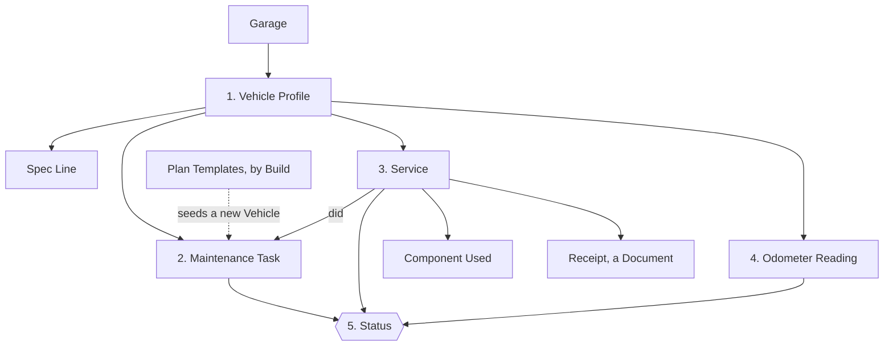
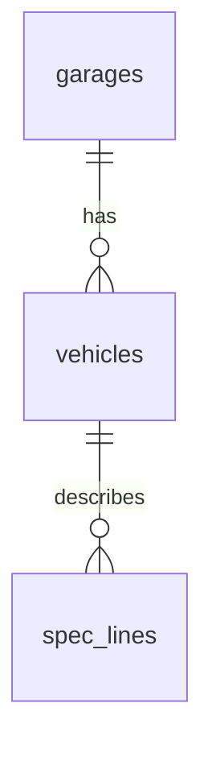
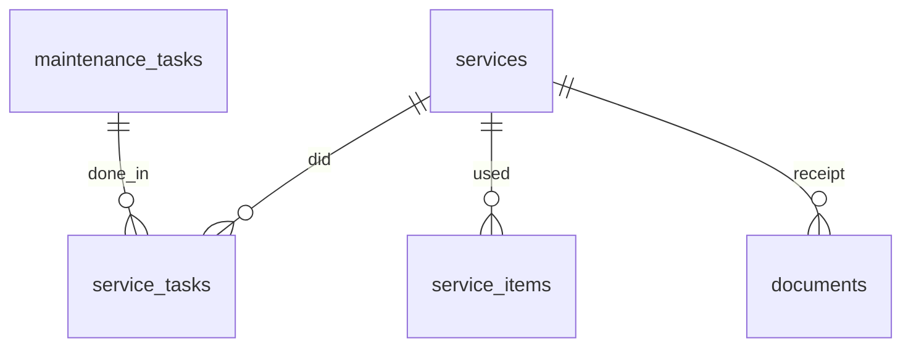

# Data model

How TMY Garage's data is organised: what is stored, how the pieces connect, and which rules protect them. The words used here (Vehicle, Service, Spec Line…) are defined in [CONTEXT.md](../CONTEXT.md).

The source of truth is the code: [`src/server/db.ts`](../src/server/db.ts) for the tables, [`src/shared/types.ts`](../src/shared/types.ts) for how the app sees them, and [`src/shared/catalogue.ts`](../src/shared/catalogue.ts) for the built-in plan templates. If this page and the code disagree, the code is right and this page needs fixing.

## The short version

The app rests on five parts.

1. **Vehicle Profile**: who the Vehicle is (`vehicles`) and its factory specs, a simple list of labelled values (`spec_lines`).
2. **Maintenance Plan**: the Vehicle's own Tasks (`maintenance_tasks`), each with an Action, an Interval, a Category and Notes. A new Vehicle starts from the **Plan Templates** that fit its Build; after that the plan is the owner's.
3. **Service History Log**: Services (`services`) with who did the work, the total cost, the Tasks done (`service_tasks`), the components used (`service_items`) and a receipt (`documents`).
4. **Mileage Log**: dated odometer values (`odometer_readings`, and each Service's own).
5. **Status**: never stored. It is worked out from the other four (see [Worked out, not stored](#worked-out-not-stored)).

## Where the data lives

Everything below sits in the folder set by the `DATA_DIR` environment variable. None of it goes in git.

| What | Where | Notes |
| --- | --- | --- |
| The database | `garage.sqlite` | One SQLite file holding every table on this page (see [ADR 0002](adr/0002-self-hosted-on-nas-with-sqlite.md)). |
| Document files | `uploads/<document id>` | The database only holds their details. |
| Automatic backups | `backups/garage-v<version>-<time>.sqlite` | Written before any schema update of an existing database. |
| Push notification keys | `push-keys.json` | The server's own keys for sending Reminders. |

Two more places hold data:

- **The code** holds the built-in Plan Templates. They are not in the database, so a new release can improve them. See [Plan Templates](#plan-templates).
- **The phone** holds an offline copy. See [The offline copy](#the-offline-copy).

## Conventions

These apply to every table, and the tables below don't repeat them.

- **`id`** is the primary key, a random UUID, unless the table says otherwise. The server creates it, except for Services and Odometer Readings: the phone creates theirs, so that a write sent twice from the offline queue updates one record instead of making two.
- **`created_at`** is when the row was added, in UTC, filled in by the database.
- **`sort`** is a line's position within its parent.
- **Dates** are text in `YYYY-MM-DD` form. **Distances** are whole kilometres.
- **Yes/no values** are stored as 0 or 1.
- **Amounts** are plain numbers. No currency is stored.
- **Empty means unknown.** A column is required only where the tables below say so.

In the column tables, **required** means the database refuses an empty value, and **→ `table`** means the column points at a row of that table.

## 1. Vehicle Profile

### `garages`

| Column | Meaning |
| --- | --- |
| `name` | Required. |

### `vehicles`

A Vehicle is never deleted from the database. It is sold, hidden from the garage page, or both.

| Column | Meaning |
| --- | --- |
| `garage_id` | Required. → `garages`. |
| `kind` | Required. `car` or `motorcycle`. |
| `name` | Required. The owner's name for it. |
| `make` | Brand. |
| `model` | Model. |
| `year` | Year. |
| `vin` | Vehicle identification number. |
| `status` | Required. `owned` or `sold`, `owned` by default. A sold Vehicle keeps its history and has nothing due. |
| `sold_date` | Set when sold. |
| `sold_odometer` | Set when sold. |
| `sold_price` | Set when sold. |
| `on_garage_page` | Required. Whether it has a card on the garage page, whatever its status. Selling hides it, and the owner can change that. |

The Build columns decide which Plan Templates a new Vehicle gets:

| Column | Applies to | Values |
| --- | --- | --- |
| `fuel` | Both | `petrol`, `flexfuel`, `diesel`, `hybrid`, `phev`, `electric`. A motorcycle is only `petrol` or `electric`. |
| `transmission` | Both | `manual`, `automatic`, `dct`, `cvt`, `e_cvt`, `single_speed`. |
| `drivetrain` | Cars | `fwd`, `rwd`, `awd`. |
| `distribution` | Cars | The timing drive: `belt`, `chain`, or `none` on an electric car. |
| `final_drive` | Motorcycles | `chain`, `belt`, `shaft`, `gear`, `none`. |
| `cooling` | Motorcycles | `liquid`, `air`. |
| `cylinders` | Motorcycles | 1 or more. |
| `has_hydraulic_clutch` | Motorcycles with a manual gearbox | Required, yes/no. |
| `has_turbo` | Cars | Required, yes/no. |
| `has_direct_injection` | Cars | Required, yes/no. |
| `has_start_stop` | Cars | Required, yes/no. |
| `has_adblue` | Cars | Required, yes/no. |
| `has_ac` | Cars | Required, yes/no. |
| `has_air_suspension` | Cars | Required, yes/no. |

A new Vehicle must give its whole Build, and the server refuses impossible combinations (a hybrid with a manual gearbox, for example). A Vehicle added before this rule may still have gaps; an empty fuel counts as a combustion engine.

### `spec_lines`

A Vehicle's factory specs, one labelled value per row (for example "Engine oil: 10W-40, 3.2 L", "Front tyre: 120/70 ZR17, 2.5 bar", "Drain plug: 30 Nm"). Tasks do not link to them: a Task names what it needs in its Notes.

| Column | Meaning |
| --- | --- |
| `vehicle_id` | Required. → `vehicles`. |
| `label` | Required. What it is. Each label appears once per Vehicle. |
| `value` | Required. The figure or reference. |
| `spec_group` | Required. `fluids`, `parts`, `torque` or `other`. |
| `sort` | Required. Position within its group. |

## 2. Maintenance Plan

### `maintenance_tasks`

| Column | Meaning |
| --- | --- |
| `vehicle_id` | Required. → `vehicles`. |
| `name` | Required. Names the job, in English. |
| `name_fr` | The French name, shown instead in French. |
| `action` | Required. `replace`, `inspect`, `clean` or `adjust`. |
| `interval_km` | Distance Interval. |
| `interval_months` | Time Interval. At least one of the two is required: a distance only, a time only, or both (whichever comes first). |
| `baseline_date` | When it was last done before the garage tracked it. Any Service supersedes it. |
| `baseline_odometer` | The odometer at that time. Needs a baseline date. |
| `category` | `engine`, `transmission`, `brakes`, `chassis`, `electrical`, `cooling_climate` or `other`. Empty means `other`. |
| `notes` | Instructions, torque values, fluid reminders, standard part codes, links. |
| `switched_off` | Required, yes/no. Paused on this Vehicle: no Due Date, no Reminder. |

### Plan Templates

The Templates are the built-in list in [`catalogue.ts`](../src/shared/catalogue.ts) (name in both languages, Action, Category, Interval, and the Build details it applies to), plus the owner's changes in `catalogue_parts`.

- A **new Vehicle** gets the Templates that fit its Build as Tasks, at the Template's Interval (shorter engine oil distance with a turbo).
- After that the Vehicle's Tasks are its own. Changing a Template, or the Vehicle's Build, never changes them.
- **Add missing tasks from templates** (on the Vehicle page) gives an existing Vehicle the Templates it has no Task named like yet.
- **Settings** edits the Templates: a built-in one's Interval, Build details or removal, and the owner's own Templates (name, Action, Category, Interval, Build details).

### `catalogue_parts`

The key is `garage_id` and `code`. This table has no `id`. The columns `unit` and `characteristics` are no longer used.

| Column | Meaning |
| --- | --- |
| `garage_id` | Required. → `garages`. |
| `code` | Required. A built-in code, or `own_<uuid>` for the owner's own Template. |
| `kind` | `car` or `motorcycle`. **Empty means the row changes a built-in Template**, and filled means it is a whole Template of the owner's. |
| `name`, `name_fr` | Own Templates only. |
| `category` | Own Templates only. |
| `action` | Own Templates only. A built-in Template's Action comes from its name. |
| `interval_km`, `interval_months` | The default Interval: for an own Template always, for a built-in one only when `interval_set` is 1. |
| `interval_set` | Required, yes/no. A built-in Template whose default Interval is the owner's. |
| `conditions` | JSON: for each detail of the Build, the values allowed. Empty keeps a built-in Template's own conditions. |
| `removed` | Required, yes/no. A built-in Template taken off the list. |

For example, conditions of `{"fuel":["diesel"],"hasTurbo":["true"]}` mean a Vehicle gets the Template only if it runs on diesel and has a turbo. A detail that isn't listed doesn't matter.

## 3. Service History Log

### `services`

| Column | Meaning |
| --- | --- |
| `vehicle_id` | Required. → `vehicles`. |
| `date` | Required. |
| `odometer` | Required only when a Task done counts distance; time-based Tasks alone may leave it out. |
| `kind` | Required. `maintenance` (it did Tasks of the plan) or `repair` (outside the plan). `maintenance` by default. |
| `title` | A repair's title, such as "New starter motor". Required for a repair, empty for maintenance. |
| `category` | A repair's category, same values as a Task's. Empty means `other`. |
| `performed_by` | Required. `diy`, `garage` (independent garage) or `dealership`. `diy` by default. |
| `total_cost` | Parts and labour in one amount. |
| `notes` | Free text. |

A maintenance Service did at least one Task; a repair needs a title and may have none. Logging a Service restarts the count of each Task it did. A logged Service can be edited.

### `service_tasks`

The Tasks done in a Service. The key is `service_id` and `task_id`.

| Column | Meaning |
| --- | --- |
| `service_id` | Required. → `services`. |
| `task_id` | Required. → `maintenance_tasks`. |

### `service_items`

The components used in a Service. The key is `service_id` and `sort`.

| Column | Meaning |
| --- | --- |
| `service_id` | Required. → `services`. |
| `description` | Required. Brand and variant, such as "Motul 7100 10W-40". |
| `part_number` | |
| `quantity` | Required. |
| `unit` | Required. `piece` or `litre`. |

### `documents`

A Document belongs to one owner, named by `owner_kind` and `owner_id`. Only those of a Service (its receipt) and of a Vehicle are shown. Documents of removed features (insurance, inspections) stay stored, unshown. The server checks the owner exists and removes a Service's Documents, files included, when it is deleted.

| Column | Meaning |
| --- | --- |
| `garage_id` | Required. → `garages`. |
| `vehicle_id` | → `vehicles`. |
| `owner_kind` | Required. `service` or `vehicle` (older rows may hold other kinds). |
| `owner_id` | Required. The owner's `id`. |
| `type` | Required. `invoice` for a receipt. |
| `title`, `issue_date`, `expiry_date` | Not used for receipts. |
| `file_name` | Required. The original name. |
| `content_type` | Required. Such as `application/pdf`. |
| `size` | Required. In bytes. |

## 4. Mileage Log

### `odometer_readings`

| Column | Meaning |
| --- | --- |
| `vehicle_id` | Required. → `vehicles`. |
| `date` | Required. |
| `odometer` | Required. |

The Mileage Log of a Vehicle is its readings together with its Services' odometer values.

## 5. Worked out, not stored

These values are always calculated from the records above, so they can't drift out of step with the history. The code is in [`src/shared`](../src/shared).

| Value | How it is worked out |
| --- | --- |
| Current odometer | The latest value logged in a reading or a Service. It is never estimated. |
| Daily distance | The rate between logged values, using the last 180 days where possible and at least 14 days of history. |
| Due Date | From the last Service (or the baseline): the time Interval added to its date, and the distance Interval added to its odometer, projected to a date with the daily distance. The earlier of the two. A date from a distance is a projection, and the screens mark it "≈". |
| Status | `overdue` when either Interval is used up. `dueSoon` when 10% or less of either is left (of the distance, or of the days between the last Service and the time due date). `ok` otherwise. `unknown` when the Task was never done, and `paused` when it is switched off. |

## Reminders

These tables are for the server only and never reach the phone's offline copy. A Reminder is sent when a Task becomes Due soon or Overdue.

### `push_subscriptions`

A device that asked for Reminders. The key is `endpoint`.

| Column | Meaning |
| --- | --- |
| `endpoint` | The device's address at its browser's push service. |
| `garage_id` | Required. → `garages`. |
| `p256dh` | Required. The device's encryption key. |
| `auth` | Required. The device's authentication secret. |
| `lang` | Required. `en` or `fr`. |

### `reminders_sent`

What has already gone out, so that each Reminder is sent once per status, and weekly while overdue. The key is `garage_id`, `key` and `status`.

| Column | Meaning |
| --- | --- |
| `garage_id` | Required. → `garages`. |
| `key` | Required. Names one occurrence: a Task since it was last done. Doing the job starts a new key. |
| `status` | Required. `dueSoon` or `overdue`. |
| `sent_on` | Required. |

### `reminder_runs`

The day's run is recorded here so that it happens once. The key is `garage_id`.

| Column | Meaning |
| --- | --- |
| `garage_id` | → `garages`. |
| `last_date` | Required. |

## Deleting things

Foreign keys stop anything from being deleted while other rows still need it, except in the cases below. The server adds its own rules on top.

| Deleting | What happens |
| --- | --- |
| Vehicle | Not possible. It can be sold or hidden instead. |
| Maintenance Task | Refused if a Service used it. Otherwise it goes. |
| Service | Its Task links, components and Documents go too. |
| Spec Line | Goes. |
| A Plan Template of the owner's | Goes. Vehicles keep their Tasks. |
| A built-in Plan Template | It can't be deleted. It can only be taken off the list, or set back to the built-in version. |

## The offline copy

The phone keeps one `Snapshot` (defined in [`types.ts`](../src/shared/types.ts)) so it works in the garage with no signal. This design is explained in [ADR 0001](adr/0001-offline-service-logging-via-send-queue.md).

- The snapshot holds Vehicles, Tasks, Services, readings, Spec Lines and the Template changes. It holds Document details, but not the files.
- It groups data the way screens use it, not the way tables store it. For example, a Service carries its `taskIds` and `partsUsed` as lists.
- Services and Odometer Readings can be logged offline. They wait in a queue on the phone and are sent when the connection returns. Everything else needs a connection.
- A phone may hold a snapshot saved by an older version of the app. `normalizeSnapshot` in [`workshop.ts`](../src/shared/workshop.ts) fills in what it lacks, and drops fields that no longer exist.

## The rework onto these five parts

The update that introduced this model ran once, after a backup, in [`five-parts.ts`](../src/server/five-parts.ts). Nothing the owner entered was lost:

| Before | Now |
| --- | --- |
| Insurance (Policies, Terms, Covers, Claims, Drivers), Quotes, Technical Inspections, Modifications | Removed with their tables. Their Documents stay stored but are no longer shown. |
| Vehicle columns for registration, first registration, version, fiscal power, national type, purchase date, parking | Dropped. VIN stays. |
| Part Specs and Vehicle Specs | One Spec Line each (label and value from the name and details; a part set aside, or one with nothing filled in, has nothing to keep). |
| Required Parts, Required Tools, linked specs, Workshop Notes | Written into the Task's Notes. |
| A Task whose part was set aside, or no longer fitting the Build | Switched off, as it was paused before. |
| A Task named after its part | Named for the job, with its Category. |
| Official Interval | Folded into the Interval (the stricter of the two applied). |
| Parts Used (with price, supplier) | Components Used; the supplier goes into the description, and the prices are summed into the Service's total cost. |
| Tasks' Action | Guessed from the name; Replace when unsure. |
| Who did a Service | `diy` for every Service already logged. |
| Shopping List | Removed. |

## Changing the data model

1. **Add a new migration** at the end of `MIGRATIONS` in [`db.ts`](../src/server/db.ts). Never edit one that has shipped. The database records how many it has run, and the server applies the rest at startup, each in a transaction, after taking a backup.
2. **Update the rest of the chain** as needed: `types.ts`, `schemas.ts` for what the server accepts, `app.ts`, and `normalizeSnapshot` for any new field in the snapshot.
3. **Add a migration test** that starts from the version just before the new migration.
4. **Update this page**, and [CONTEXT.md](../CONTEXT.md) if a term's meaning changed.
5. **Keep it fake.** This repository is public, so examples and test data must never contain real vehicle details (see [CLAUDE.md](../CLAUDE.md)).
