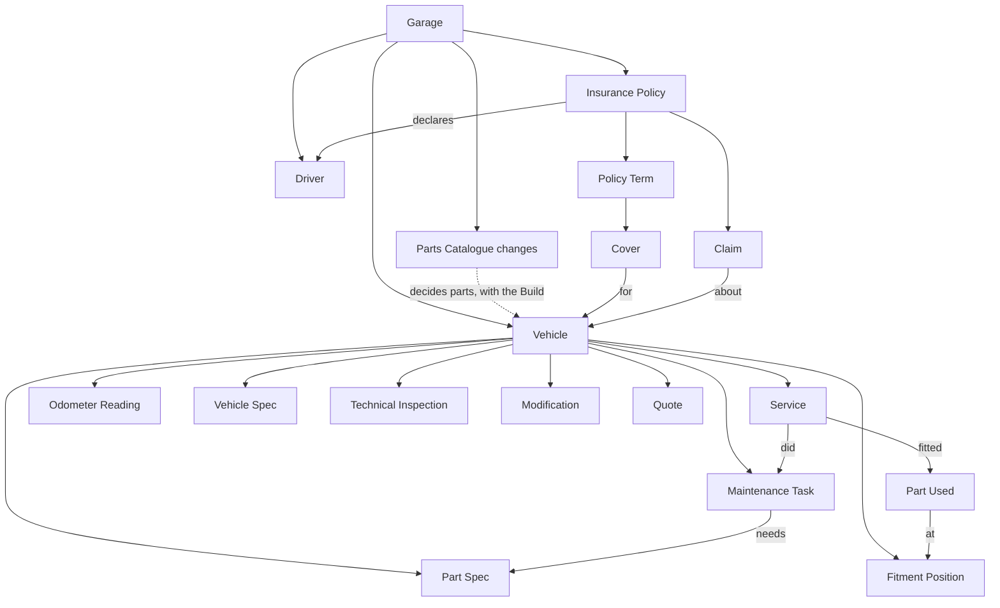
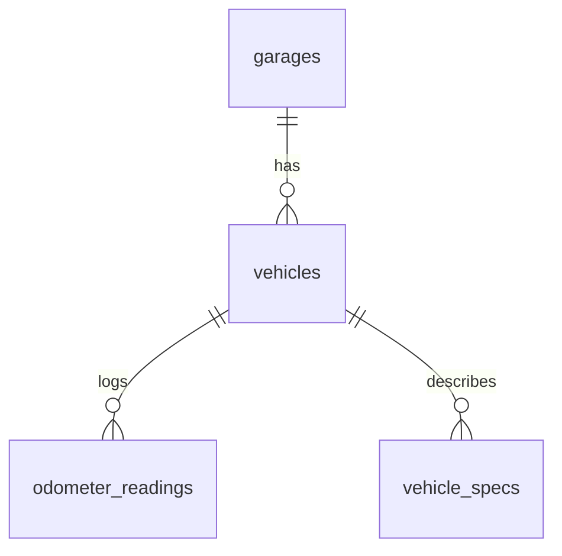
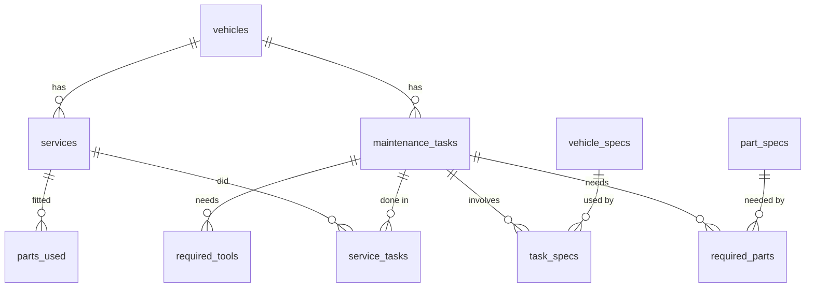
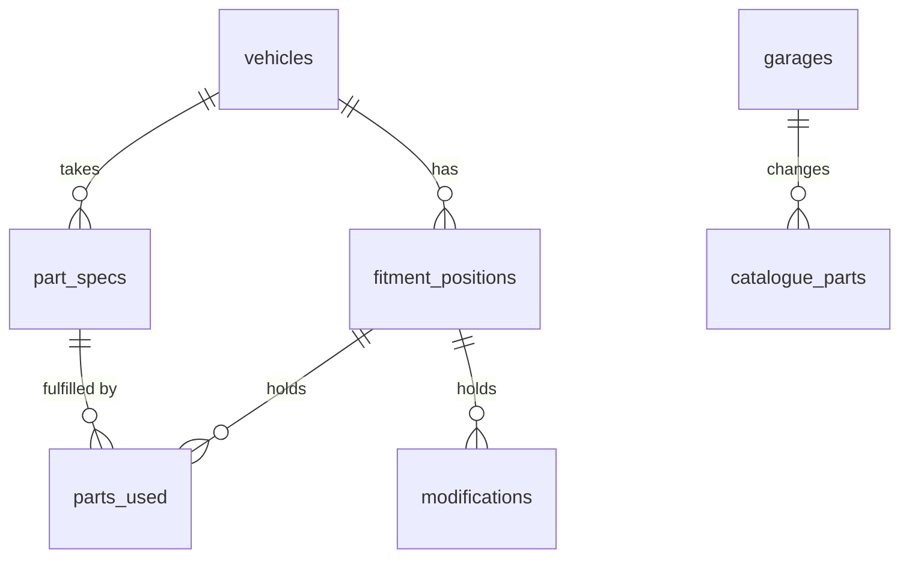
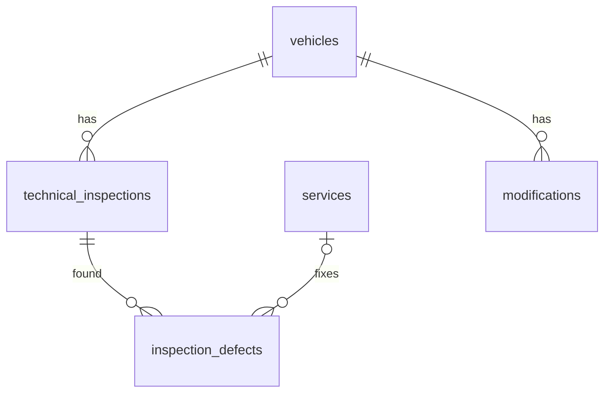
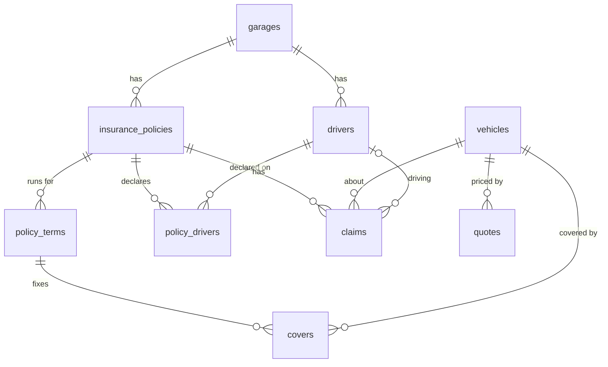

# Data model

How TMY Garage's data is organised: what is stored, how the pieces connect, and which rules protect them. The words used here (Vehicle, Service, Part Spec…) are defined in [CONTEXT.md](../CONTEXT.md).

The source of truth is the code: [`src/server/db.ts`](../src/server/db.ts) for the tables, [`src/shared/types.ts`](../src/shared/types.ts) for how the app sees them, and [`src/shared/catalogue.ts`](../src/shared/catalogue.ts) for the built-in parts. If this page and the code disagree, the code is right and this page needs fixing.

## The short version

- A **Garage** holds everything. Each user has one, and today the app runs with a single Garage.
- A Garage has **Vehicles**, and nearly everything hangs off a Vehicle: its **Maintenance Tasks**, its **Services**, its **Odometer Readings**, its **Part Specs**, its **Technical Inspections** and its **Modifications**.
- A Vehicle's **Build** (fuel, gearbox, timing drive, options…) and the **Parts Catalogue** decide which **Standard Parts** it has. Those parts bring their Part Specs, Fitment Positions and Maintenance Tasks with them.
- Logging a **Service** says which Tasks were done and which parts went on. What is due next is worked out from that history and never stored.
- **Insurance** sits beside the Vehicles: a Policy has yearly Terms, and each Term has one Cover per Vehicle.
- **Documents** are stored files that can be attached to almost anything.

## Where the data lives

Everything below sits in the folder set by the `DATA_DIR` environment variable. None of it goes in git.

| What | Where | Notes |
| --- | --- | --- |
| The database | `garage.sqlite` | One SQLite file holding every table on this page (see [ADR 0002](adr/0002-self-hosted-on-nas-with-sqlite.md)). |
| Document files | `uploads/<document id>` | The database only holds their details. |
| Automatic backups | `backups/garage-v<version>-<time>.sqlite` | Written before any schema update of an existing database. |
| Push notification keys | `push-keys.json` | The server's own keys for sending Reminders. |

Two more places hold data:

- **The code** holds the built-in Parts Catalogue. It is not in the database, so a new release can improve it. See [The Parts Catalogue](#the-parts-catalogue).
- **The phone** holds an offline copy. See [The offline copy](#the-offline-copy).

## Conventions

These apply to every table, and the tables below don't repeat them.

- **`id`** is the primary key, a random UUID, unless the table says otherwise. The server creates it, except for Services and Odometer Readings: the phone creates theirs, so that a write sent twice from the offline queue updates one record instead of making two.
- **`created_at`** is when the row was added, in UTC, filled in by the database.
- **`sort`** is a line's position within its parent.
- **Dates** are text in `YYYY-MM-DD` form. **Distances** are whole kilometres.
- **Yes/no values** are stored as 0 or 1.
- **Amounts** are plain numbers. No currency is stored.
- **Empty means unknown.** A column is required only where the tables below say so.

In the column tables, **required** means the database refuses an empty value, and **→ `table`** means the column points at a row of that table.

## Garage and Vehicles

### `garages`

| Column | Meaning |
| --- | --- |
| `name` | Required. The Garage's name. |

The first Garage is created with the id `default`.

### `vehicles`

A Vehicle is never deleted from the database. It is sold, hidden from the garage page, or both.

| Column | Meaning |
| --- | --- |
| `garage_id` | Required. → `garages`. |
| `kind` | Required. `car` or `motorcycle`. |
| `name` | Required. The owner's name for it. |
| `make` | Manufacturer. |
| `model` | Model. |
| `year` | Year. |
| `registration` | Plate number. |
| `first_registration` | Carte grise field B. Sets when the first Technical Inspection is due. |
| `vin` | Carte grise field E. |
| `version` | Carte grise field D.2. |
| `fiscal_power` | Carte grise field P.6. |
| `national_type` | Carte grise field J.1. |
| `purchase_date` | When the owner bought it. |
| `overnight_parking` | For a Quote Pack: `closedGarage`, `privateParking` or `street`. |
| `status` | Required. `owned` or `sold`, `owned` by default. A sold Vehicle keeps its history and has nothing due. |
| `sold_date` | Set when sold. |
| `sold_odometer` | Set when sold. |
| `sold_price` | Set when sold. |
| `on_garage_page` | Required. Whether it has a card on the garage page, whatever its status. Selling hides it, and the owner can change that. |

The Build columns decide which Standard Parts the Vehicle has:

| Column | Applies to | Values |
| --- | --- | --- |
| `fuel` | Both | `petrol`, `flexfuel`, `diesel`, `hybrid`, `phev`, `electric`. A motorcycle is only `petrol` or `electric`. |
| `transmission` | Both | `manual`, `automatic`, `dct`, `cvt`, `e_cvt`, `single_speed`. |
| `drivetrain` | Cars | `fwd`, `rwd`, `awd`. |
| `distribution` | Cars | The timing drive: `belt`, `chain`, or `none` on an electric car. |
| `final_drive` | Motorcycles | `chain`, `belt`, `shaft`, `gear`, `none`. |
| `cooling` | Motorcycles | `liquid`, `air`. |
| `cylinders` | Motorcycles | 1 or more. |
| `has_hydraulic_clutch` | Motorcycles with a manual gearbox | Required, yes/no. |
| `has_turbo` | Cars | Required, yes/no. |
| `has_direct_injection` | Cars | Required, yes/no. |
| `has_start_stop` | Cars | Required, yes/no. |
| `has_adblue` | Cars | Required, yes/no. |
| `has_ac` | Cars | Required, yes/no. |
| `has_air_suspension` | Cars | Required, yes/no. |

A new Vehicle must give its whole Build, and the server refuses impossible combinations (a hybrid with a manual gearbox, for example). A Vehicle added before this rule may still have gaps. An empty fuel counts as a combustion engine, so such a Vehicle keeps its engine parts.

### `odometer_readings`

| Column | Meaning |
| --- | --- |
| `vehicle_id` | Required. → `vehicles`. |
| `date` | Required. |
| `odometer` | Required. |

### `vehicle_specs`

Reference data from the manuals, such as a torque value or a tyre pressure.

| Column | Meaning |
| --- | --- |
| `vehicle_id` | Required. → `vehicles`. |
| `kind` | Required. `torque` or `other`. |
| `name` | Required. |
| `value` | Required. Free text, such as "30 Nm". |
| `notes` | |

## Maintenance

### `maintenance_tasks`

The database refuses a Task with neither a distance nor a time interval.

| Column | Meaning |
| --- | --- |
| `vehicle_id` | Required. → `vehicles`. |
| `name` | Required. The English name. |
| `name_fr` | The French name, when there is one. |
| `interval_km` | The owner's distance interval. |
| `interval_months` | The owner's time interval. |
| `official_interval_km` | The Official Interval from the Service Schedule. The stricter of this and `interval_km` applies. |
| `official_interval_months` | The same, for time. |
| `baseline_date` | When the job was last done before tracking started. Any Service replaces it. |
| `baseline_odometer` | The odometer at that time. |
| `workshop_notes` | Free-text steps and warnings. |
| `standard_part` | The code of the Standard Part this Task replaces. The Task is paused while that part is not on the Vehicle. |
| `custom_interval` | Required, yes/no. No means the interval follows the Build (shorter with a turbo, for example). Yes means the owner set it. |
| `category` | The group chosen by the owner, for a Task that replaces no part. A Task that replaces a part takes the part's category. |

### `services`

| Column | Meaning |
| --- | --- |
| `vehicle_id` | Required. → `vehicles`. |
| `date` | Required. |
| `odometer` | May be left out only when all the Service's Tasks are time-based. The Service form checks this; the server accepts either. |
| `notes` | |

### `service_tasks`

Which Tasks a Service did. The key is the pair of columns.

| Column | Meaning |
| --- | --- |
| `service_id` | Required. → `services`. |
| `task_id` | Required. → `maintenance_tasks`. |

### `parts_used`

What actually went on during a Service. A line keeps its own description, so the history stays readable if the linked Part Spec is deleted. The key is `service_id` and `sort`.

| Column | Meaning |
| --- | --- |
| `service_id` | Required. → `services`. |
| `sort` | Required. |
| `part_spec_id` | → `part_specs`. The Part Spec this line fulfils. |
| `position_id` | → `fitment_positions`. Where it was fitted. |
| `description` | Required. Brand and product as bought. |
| `part_number` | |
| `quantity` | Required. |
| `unit` | Required. `piece` or `litre`. |
| `price` | |
| `supplier` | |

### `required_parts`

The parts a Task needs. The key is `task_id` and `part_spec_id`.

| Column | Meaning |
| --- | --- |
| `task_id` | Required. → `maintenance_tasks`. |
| `part_spec_id` | Required. → `part_specs`. |
| `quantity` | Above 0. Empty until the owner says how much, and the Shopping List then says to check it. |
| `sort` | Required. |

### `required_tools`

A Task's tool checklist. The key is `task_id` and `sort`.

| Column | Meaning |
| --- | --- |
| `task_id` | Required. → `maintenance_tasks`. |
| `sort` | Required. |
| `name` | Required. Such as "torque wrench 5–60 Nm". |

### `task_specs`

The Vehicle Specs a Task involves. The key is the pair of columns.

| Column | Meaning |
| --- | --- |
| `task_id` | Required. → `maintenance_tasks`. |
| `spec_id` | Required. → `vehicle_specs`. |

## Parts

### `part_specs`

What a Vehicle takes for one Part. A Vehicle has at most one row per Standard Part.

| Column | Meaning |
| --- | --- |
| `vehicle_id` | Required. → `vehicles`. |
| `standard_part` | The Standard Part's code. Empty for a part the owner named. |
| `name` | Required. Used on screen for a part with no catalogue code. A Standard Part is named by the catalogue instead. |
| `name_fr` | The French name. |
| `characteristics` | Such as "10W-40, JASO MA2". |
| `oem_reference` | The manufacturer's own part number. |
| `part_numbers` | Equivalents that also fit. |
| `unit` | Required. `piece` or `litre`. |
| `not_fitted` | Required, yes/no. A Standard Part set aside as not on this Vehicle. |

### `fitment_positions`

A location holding one Part at a time. A fitted Standard Part gets one automatically; oils and fluids don't. What is fitted there now is never stored: it is the latest Part Used or Modification at that position.

| Column | Meaning |
| --- | --- |
| `vehicle_id` | Required. → `vehicles`. |
| `standard_part` | The Standard Part's code. Empty for an older position the owner named. |
| `name` | Required. Used on screen only when `standard_part` is empty. |

### The Parts Catalogue

The catalogue is two lists merged by the `Catalogue` class in [`catalogue.ts`](../src/shared/catalogue.ts):

1. **Built-in parts**, in `PART_TEMPLATES` in the code, each with a code, names, unit, category, default interval and conditions on the Build.
2. **The owner's changes**, in the `catalogue_parts` table: one row per changed or added part, for each Garage.

A part with no row is used exactly as built in, so a Garage with no changes has an empty table. Standard Part codes are not foreign keys, because most of them point at the code rather than at a table.

### `catalogue_parts`

The key is `garage_id` and `code`. This table has no `id`.

| Column | Meaning |
| --- | --- |
| `garage_id` | Required. → `garages`. |
| `code` | Required. A built-in code, or `own_<uuid>` for the owner's own part. |
| `kind` | `car` or `motorcycle`. **Empty means the row changes a built-in part**, and filled means it is a whole part of the owner's. |
| `name` | Own parts only. |
| `name_fr` | Own parts only. |
| `unit` | Own parts only: `piece` for fitted, `litre` for a fluid. |
| `category` | Own parts only. |
| `interval_km` | Own parts only. |
| `interval_months` | Own parts only. |
| `conditions` | JSON: for each detail of the Build, the values allowed. Empty keeps a built-in part's own conditions. |
| `characteristics` | Default details for matching Vehicles' Part Specs. |
| `removed` | Required, yes/no. A built-in part taken off the list. |

For example, conditions of `{"fuel":["diesel"],"hasTurbo":["true"]}` mean a Vehicle has the part only if it runs on diesel and has a turbo. A detail that isn't listed doesn't matter.

### What follows from the Build and the catalogue

When a Vehicle is added, its Build changes or the catalogue changes, the server (`syncStandardParts`, `syncSchedule`) brings the Vehicle's rows into line:

| Situation | What happens |
| --- | --- |
| A part now fits | The Vehicle gets its Part Spec, its Fitment Position if fitted, and an owned Vehicle gets its Task. A part set aside earlier comes back. |
| A part no longer fits, and is untouched | Its Part Spec is marked `not_fitted`, which pauses its Task. |
| A part no longer fits, but is in use | It stays on the Vehicle, and the screens flag it. |
| A part's fit did not change | The owner's own "not on this vehicle" choice is left alone. |

A part is **in use** when its Part Spec has been filled in, a Task gives a quantity for it, or a Part Used refers to it. Default details and required parts with no quantity don't count.

## Inspections and Modifications

### `technical_inspections`

| Column | Meaning |
| --- | --- |
| `vehicle_id` | Required. → `vehicles`. |
| `date` | Required. |
| `odometer` | Required. |
| `centre` | |
| `result` | Required. `passed`, `majorDefects` or `criticalDefects`. |
| `next_due_date` | As printed on the report. When empty, the app estimates it from the regulatory rhythm. |
| `notes` | |

### `inspection_defects`

The key is `inspection_id` and `sort`.

| Column | Meaning |
| --- | --- |
| `inspection_id` | Required. → `technical_inspections`. |
| `sort` | Required. |
| `description` | Required. |
| `severity` | Required. `minor`, `major` or `critical`. |
| `fixed_service_id` | → `services`. The Service that fixed it. |

### `modifications`

| Column | Meaning |
| --- | --- |
| `vehicle_id` | Required. → `vehicles`. |
| `name` | Required. |
| `fitted_date` | Required. |
| `fitted_odometer` | |
| `removed_date` | |
| `position_id` | → `fitment_positions`. |
| `declared_to_insurer` | Required, yes/no. |
| `notes` | |

## Insurance

A Quote is deliberately not linked to a Policy. It uses the same terms as a Cover so that the two can be compared.

### `drivers`

| Column | Meaning |
| --- | --- |
| `garage_id` | Required. → `garages`. |
| `name` | Required. |
| `birth_date` | |
| `car_licence_date` | |
| `motorcycle_licence_date` | |
| `motorcycle_licence` | `A1`, `A2` or `A`. The server checks this. |
| `notes` | |

### `insurance_policies`

| Column | Meaning |
| --- | --- |
| `garage_id` | Required. → `garages`. |
| `insurer` | Required. |
| `policy_number` | |
| `start_date` | Required. |
| `cancelled_date` | |
| `notes` | |

### `policy_drivers`

Which Drivers a Policy declares. The key is the pair of columns.

| Column | Meaning |
| --- | --- |
| `policy_id` | Required. → `insurance_policies`. |
| `driver_id` | Required. → `drivers`. |

### `policy_terms`

The end date must be after the start date.

| Column | Meaning |
| --- | --- |
| `policy_id` | Required. → `insurance_policies`. |
| `start_date` | Required. |
| `end_date` | Required. The renewal date (échéance). |
| `notes` | |

### `covers`

One row per Vehicle in each Term.

| Column | Meaning |
| --- | --- |
| `term_id` | Required. → `policy_terms`. |
| `vehicle_id` | Required. → `vehicles`. |
| `level` | Required. `thirdParty`, `thirdPartyExtended` or `comprehensive`. |
| `guarantees` | Optional guarantees, as free text. |
| `excess` | Franchise. |
| `premium` | Yearly premium. |
| `crm` | The bonus-malus coefficient of this Vehicle on this Policy. |
| `notes` | |

### `claims`

| Column | Meaning |
| --- | --- |
| `policy_id` | Required. → `insurance_policies`. |
| `vehicle_id` | Required. → `vehicles`. |
| `driver_id` | → `drivers`. |
| `date` | Required. |
| `responsibility` | Required. `notAtFault`, `partlyAtFault` or `atFault`. |
| `amount` | |
| `description` | Required. |
| `notes` | |

### `quotes`

| Column | Meaning |
| --- | --- |
| `vehicle_id` | Required. → `vehicles`. |
| `insurer` | Required. |
| `date` | Required. |
| `level` | Required. The same values as a Cover. |
| `guarantees` | |
| `excess` | |
| `premium` | Required. |
| `valid_until` | |
| `notes` | |

## Documents

### `documents`

A Document belongs to one owner, named by `owner_kind` and `owner_id`. The database can't check that this owner exists, because it could be in any of seven tables, so the server checks it and removes a record's Documents when the record is deleted.

| Column | Meaning |
| --- | --- |
| `garage_id` | Required. → `garages`. |
| `vehicle_id` | → `vehicles`. Empty for a Policy's Document, since a Policy can cover several Vehicles. |
| `owner_kind` | Required. `vehicle`, `service`, `modification`, `inspection`, `policy`, `cover` or `claim`. |
| `owner_id` | Required. The owner's `id`. |
| `type` | Required. `registration`, `invoice`, `inspectionReport`, `manual`, `photo`, `policySchedule`, `insuranceCertificate`, `claimsStatement`, `claimReport` or `other`. |
| `title` | |
| `issue_date` | |
| `expiry_date` | Reminders use it. |
| `file_name` | Required. The original name. |
| `content_type` | Required. Such as `application/pdf`. |
| `size` | Required. In bytes. |

## Reminders

These tables are for the server only and never reach the phone's offline copy.

### `push_subscriptions`

A device that asked for Reminders. The key is `endpoint`.

| Column | Meaning |
| --- | --- |
| `endpoint` | The device's address at its browser's push service. |
| `garage_id` | Required. → `garages`. |
| `p256dh` | Required. The device's encryption key. |
| `auth` | Required. The device's authentication secret. |
| `lang` | Required. `en` or `fr`. |

### `reminders_sent`

What has already gone out, so that each Reminder is sent once per status, and weekly while overdue. The key is `garage_id`, `key` and `status`.

| Column | Meaning |
| --- | --- |
| `garage_id` | Required. → `garages`. |
| `key` | Required. Names one occurrence, such as a Task since it was last done. Doing the job starts a new key. |
| `status` | Required. `dueSoon` or `overdue`. |
| `sent_on` | Required. |

### `reminder_runs`

The day's run is recorded here so that it happens once. The key is `garage_id`.

| Column | Meaning |
| --- | --- |
| `garage_id` | → `garages`. |
| `last_date` | Required. |

## One-off update lists

The server finishes two past updates itself, because they need the catalogue, which the database can't see. Each table lists the Vehicles still waiting, and each is empty once the work is done.

| Table | Column | Purpose |
| --- | --- | --- |
| `part_catalogue_moves` | `vehicle_id` → `vehicles` | Vehicles whose Standard Parts still have to move to the current catalogue codes. |
| `schedule_moves` | `vehicle_id` → `vehicles` | Vehicles whose Tasks still have to join the maintenance schedule. A sold Vehicle waits here until it is no longer sold. |

## Worked out, not stored

These values are always calculated from the records above, so they can't drift out of step with the history. The code is in [`src/shared`](../src/shared).

| Value | How it is worked out |
| --- | --- |
| Current odometer | The latest value logged in a reading, a Service or an inspection. It is never estimated. |
| Monthly distance | The rate between logged values, using the last 180 days where possible and at least 14 days of history. |
| Due Date and status | From the last Service or the baseline, the stricter interval and the distance rate. The status is `overdue`, `dueSoon`, `ok`, `unknown` or `paused`. A date from a distance is a projection, and the screens mark it "≈". |
| A Task's category | The part's category if it replaces one, otherwise the owner's choice, otherwise `other`. |
| Shopping List | The Required Parts of the Tasks coming due, added up per Part Spec. No stock is tracked. |
| What is fitted | The latest Part Used or Modification at a position. |
| Next Technical Inspection | The date on the last report, otherwise the regulatory rhythm from first registration. |

## Deleting things

Foreign keys stop anything from being deleted while other rows still need it, except in the cases below. The server adds its own rules on top.

| Deleting | What happens |
| --- | --- |
| Vehicle | Not possible. It can be sold or hidden instead. |
| Maintenance Task | Refused if a Service used it, or if it is the only Task for a part still on the Vehicle (the owner switches that off through the part). Otherwise its required parts, tools and spec links go too. |
| Service | Its Task links, Parts Used and Documents go too. A defect it fixed loses that link, so it no longer shows as fixed. |
| Part Spec | Refused for a Standard Part, which is marked as not on the Vehicle instead. Otherwise Tasks stop requiring it, and Parts Used keep their description and lose the link. |
| Fitment Position | Refused for a Standard Part's position, or if anything has been fitted there. |
| Technical Inspection | Its defects and Documents go too. |
| Modification | Its Documents go too. |
| Driver | Policies stop listing them. Their Claims stay, with nobody named as driving. |
| Insurance Policy | Its Terms, Covers, Claims, driver links and all their Documents go too. |
| Policy Term | Its Covers and their Documents go too. |
| Claim | Its Documents go too. |
| The owner's own part | What was never used is removed. Anything with history stays on the Vehicle under its name, no longer linked to the catalogue. |
| A built-in part | It can't be deleted. It can only be taken off the list, or set back to the built-in version. |

## The offline copy

The phone keeps one `Snapshot` (defined in [`types.ts`](../src/shared/types.ts)) so it works in the garage with no signal. This design is explained in [ADR 0001](adr/0001-offline-service-logging-via-send-queue.md).

- The snapshot holds Vehicles, Tasks, Services, readings, Vehicle Specs, Part Specs, positions, inspections, Modifications, Drivers, Policies, Claims, Quotes and the catalogue changes. It holds Document details, but not the files.
- It groups data the way screens use it, not the way tables store it. For example, a Task carries its `requiredParts`, `tools` and `specIds` as lists.
- Services and Odometer Readings can be logged offline. They wait in a queue on the phone and are sent when the connection returns. Everything else needs a connection.
- A phone may hold a snapshot saved by an older version of the app. `normalizeSnapshot` in [`workshop.ts`](../src/shared/workshop.ts) fills in what it lacks.

## Changing the data model

1. **Add a new migration** at the end of `MIGRATIONS` in [`db.ts`](../src/server/db.ts). Never edit one that has shipped. The database records how many it has run, and the server applies the rest at startup, each in a transaction, after taking a backup.
2. **Update the rest of the chain** as needed: `types.ts`, `schemas.ts` for what the server accepts, `app.ts`, and `normalizeSnapshot` for any new field in the snapshot.
3. **Add a migration test** that starts from the version just before the new migration.
4. **Update this page**, and [CONTEXT.md](../CONTEXT.md) if a term's meaning changed.
5. **Keep it fake.** This repository is public, so examples and test data must never contain real vehicle or insurance details (see [CLAUDE.md](../CLAUDE.md)).
