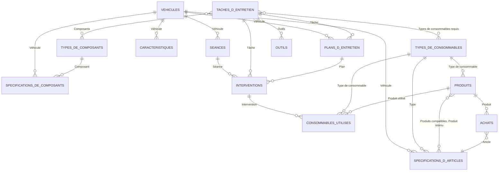

# The Notion databases

The structure of the databases under the Notion parent page (`NOTION_PARENT_PAGE_ID`), column by column, and how they link.
How the sync uses them is in [notion-copy.md](notion-copy.md); why, in [ADR 0007](adr/0007-two-way-notion-sync.md).

**Who writes each column:**
- **Owner**: typed in Notion; the app only reads it.
- **App**: rewritten by every push, so edits in Notion are lost.
- **Owner + App**: typed in Notion, or written by a desktop edit in the app (ADR 0009). The app writes only the values of these pages, never the columns.
- **Notion**: the back-link of a two-way relation, kept by Notion itself.

The app finds a database by its title and a column by its name, so renaming either breaks the sync. The two spec databases were renamed (see below): the app accepts the new title or the old one, and if both exist it reads and writes neither (a warning is shown in Settings). Extra columns are
ignored. Every relation is two-way: the column named in **Back-link** is the same link seen from the other database.

## How they link

The databases fall into five groups:

| Group | Databases | Made by |
| --- | --- | --- |
| Catalogue | Tâches d'entretien, Types de composants, Types de consommables, Produits, Outils | Owner |
| Per vehicle | Spécifications de composants, Spécifications d'articles, Plans d'entretien | Owner (the app creates plan pages, and writes spec pages on a desktop edit) |
| Purchases | Achats | Owner, read-only |
| Copied from the app | Véhicules, Séances, Interventions, Consommables utilisés | App |
| Frozen | Caractéristiques | Neither: no longer written; archived by the owner after the move (ADR 0009) |

## The category labels

The app files tasks and specs under seven categories. In Notion, the **Catégorie** of *Tâches d'entretien* uses the app's
French labels: Moteur, Transmission, Freinage, Châssis, Électricité, Refroidissement et climatisation, Autre. The app also
accepts Freins (Freinage), Roues (Châssis) and Électrique (Électricité), which *Spécifications de composants* and *Types de composants*
still use. *Types de consommables* has its own list on purpose, grouped by kind of product (Lubrifiants, Fluides, Freinage,
Filtres, Allumage, Transmission, Pneus).

## Catalogue

### Tâches d'entretien

One row per maintenance task, shared by every vehicle it applies to.

| Column | Type | Written by | Notes |
| --- | --- | --- | --- |
| Tâche | title | Owner | Required. The task name in the app. |
| Action | select | Owner | Required. Contrôle, Remplacement, Nettoyage or Réglage (the app's inspect, replace, clean, adjust). |
| Applicable si | multi-select | Owner | Required. Equipment tags, all of which the vehicle needs. Empty means every vehicle. |
| Intervalle par défaut (km) | number | Owner | Required column, may be empty. |
| Intervalle par défaut (mois) | number | Owner | Required column, may be empty. A task with neither interval is not added. |
| Catégorie | select | Owner | The section the task is listed under in the app. Empty keeps the task's own. |
| Instructions | text | Owner | Shown on the task sheet. |
| Types de consommables requis | relation → Types de consommables | Owner | Back-link: Tâches. |
| Composants | relation → Types de composants | Owner | Back-link: Tâches. Brings their torque values. |
| Outils | relation → Outils | Owner | Back-link: Tâches. |
| Plans d'entretien | relation ← Plans d'entretien | Notion | Back-link of Plans' Tâche. |
| Interventions | relation ← Interventions | Notion | Back-link of Interventions' Tâche. |

### Types de composants

A kind of part that has specs, such as torque values.

| Column | Type | Written by | Notes |
| --- | --- | --- | --- |
| Nom | title | Owner | Required. |
| Catégorie | select | Owner | Moteur, Freins, Roues, Châssis, Transmission, Électrique, Refroidissement et climatisation, Autre. |
| Notes | text | Owner | |
| Tâches | relation ← Tâches d'entretien | Notion | Back-link of Composants. |
| Spécifications de composants | relation ← Spécifications de composants | Notion | Back-link of Composant. |

### Types de consommables

A kind of consumable shared by every vehicle (engine oil, front brake pads…).

| Column | Type | Written by | Notes |
| --- | --- | --- | --- |
| Nom | title | Owner | Required. |
| Famille | select | Owner | Fluide or Pièce. |
| Catégorie | select | Owner | Lubrifiants, Fluides, Freinage, Filtres, Allumage, Transmission, Pneus. |
| Notes | text | Owner | |
| Tâches | relation ← Tâches d'entretien | Notion | Back-link of Types de consommables requis. |
| Produits | relation ← Produits | Notion | Back-link of Type de consommable. |
| Spécifications d'articles | relation ← Spécifications d'articles | Notion | Back-link of Type. |
| Consommables utilisés | relation ← Consommables utilisés | Notion | Back-link of Type de consommable. |

### Produits

A product sold, which can be picked when logging a session.

| Column | Type | Written by | Notes |
| --- | --- | --- | --- |
| Nom | title | Owner | Required. |
| Type de consommable | relation → Types de consommables | Owner | Back-link: Produits. |
| Marque, Référence, Fournisseur | text | Owner | The maker's reference lives here, not on the vehicle. |
| Prix | number (€) | Owner | A default; the price paid is logged per session. |
| Notes | text | Owner | |
| Compatible avec | relation ← Spécifications d'articles | Notion | Back-link of Produits compatibles. |
| Retenu pour | relation ← Spécifications d'articles | Notion | Back-link of Produit retenu. |
| Utilisé dans | relation ← Consommables utilisés | Notion | Back-link of Produit utilisé. |

### Outils

| Column | Type | Written by | Notes |
| --- | --- | --- | --- |
| Nom | title | Owner | Required. |
| Type | select | Owner | Clé dynamométrique, Douille, Clé, Tournevis, Spécifique, Consommable atelier. |
| Taille / capacité | text | Owner | |
| Possédé | checkbox | Owner | |
| Prix | number (€) | Owner | |
| Notes | text | Owner | |
| Tâches | relation ← Tâches d'entretien | Notion | Back-link of Outils. |

## Per vehicle

### Spécifications de composants

(Formerly *Spécifications*; both titles are accepted, and if both exist neither is read.) The **Component Specs**: a vehicle's own values for a component: torques, capacities, pressures, sizes. Written by the owner, and by the app on a desktop edit (Notion first) and by the one-off move of the old Spec Lines.

| Column | Type | Written by | Notes |
| --- | --- | --- | --- |
| Élément | title | Owner + App | Required. |
| Véhicule | relation → Véhicules | Owner + App | Required. Back-link: Spécifications. A page linked to several vehicles counts for each. |
| Valeur | number | Owner + App | Required. Text is accepted too. |
| Unité | select | Owner + App | N·m, L, mm, bar. |
| Composant | relation → Types de composants | Owner + App | Back-link: Spécifications. |
| Catégorie | select | Owner + App | Same labels as Types de composants. |
| Source | text | Owner + App | Where the value comes from. |
| Statut | select | Owner + App | Confirmé or À confirmer. |

### Spécifications d'articles

(Formerly *Consommables par véhicule*; both titles are accepted, and if both exist neither is read.) The **Item Specs**: which consumable of each type a vehicle takes, and how much. Written by the owner, and by the app on a desktop edit (Notion first) and by the one-off move of the old Spec Lines. The app never writes *Produits compatibles*.

| Column | Type | Written by | Notes |
| --- | --- | --- | --- |
| Désignation | title | Owner + App | Required. |
| Véhicule | relation → Véhicules | Owner + App | Required. Back-link: Consommables. |
| Type | relation → Types de consommables | Owner + App | Required. Back-link: Consommables par véhicule. |
| Spécification | text | Owner + App | Grade or standard (e.g. 10W-30). |
| Réf. OEM | text | Owner + App | The maker's part number. |
| Capacité | text | Owner + App | |
| Quantité | text | Owner + App | A leading number is read (e.g. "0,5 L"). |
| Produits compatibles | relation → Produits | Owner | Back-link: Compatible avec. |
| Produit retenu | relation → Produits | Owner + App | Back-link: Retenu pour. |
| Statut | select | Owner + App | Confirmé or À confirmer. |

### Plans d'entretien

One page per vehicle and task. The app creates a page when a catalogue task applies and none exists.

| Column | Type | Written by | Notes |
| --- | --- | --- | --- |
| Plan | title | App, at creation | Required. |
| Véhicule | relation → Véhicules | App, at creation | Required. Back-link: Plans d'entretien. One vehicle per page. |
| Tâche | relation → Tâches d'entretien | App, at creation | Required. Back-link: Plans d'entretien. |
| Intervalle (km), Intervalle (mois) | number | Owner | This vehicle's interval; replaces the catalogue's default where filled. |
| Dernier fait (km), Dernier fait (date) | number, date | App | From the last session that did the task, or its starting point. |
| Notes | text | Owner | Shown on the app's task. |
| Interventions | relation ← Interventions | Notion | Back-link of Interventions' Plan. |

## Purchases

### Achats

What the owner bought, by hand, for an Item Spec of a vehicle. Read-only for the app ([ADR 0008](adr/0008-shopping-list-and-purchase-log-move-to-notion.md)):
a required consumable shows as Bought when an Achat of its line is dated after the task was last done, otherwise To buy.

| Column | Type | Written by | Notes |
| --- | --- | --- | --- |
| Achat | title | Owner | Required. |
| Date | date | Owner | Required. An Achat with no date is skipped, with a warning. |
| Article | relation → Spécifications d'articles | Owner | Required. The Item Spec that was bought. An Achat with no article is skipped; with several, the first is used (warning). |
| Produit | relation → Produits | Owner | Optional. |
| Quantité | number | Owner | Optional. Text is accepted too (a leading number is read). |
| Prix payé | number (€) | Owner | Optional. |
| Boutique | text | Owner | Optional. |
| Facture | files | Owner | **Never read or copied** (privacy). |
| Notes | text | Owner | **Never read or copied** (privacy); not even in the app's description of the database. |

A missing required column (or a missing database) makes the database "incomplete": a warning is shown in Settings and nothing is removed because of it. A missing optional column is tolerated.
The app keeps only the date, the article, the product, the quantity, the price and the shop. It never creates, renames or writes this database.

## Copied from the app

Each of these databases has **ID app** (text, the app's id, which links a page to its record) and **Supprimé de l’app**
(checkbox, ticked when the record is gone from the app; the page is kept). Both are written by the app.

### Véhicules

| Column | Type | Written by | Notes |
| --- | --- | --- | --- |
| Nom | title | App | |
| Type | select | App | Voiture or Moto. |
| Marque, Modèle, Motorisation | text | App | |
| Année, Kilométrage, Km par jour | number | App | |
| Relevé le, Copié le | date | App | |
| Équipements | multi-select | Owner | Moto, Transmission chaîne, Refroidissement liquide, Frein avant disque, Frein arrière disque, ABS. Decides which catalogue tasks apply. |
| JDex | text | Owner | Filing reference. |
| Spécifications de composants, Spécifications d'articles, Plans d'entretien, Séances | relations | Notion | Back-links. |

Articles: no longer written by the app since 2026-11-10; leave or archive it in Notion.

### Séances

One per session logged in the app.

| Column | Type | Written by | Notes |
| --- | --- | --- | --- |
| Séance | title | App | |
| Véhicule | relation → Véhicules | App | Back-link: Séances. |
| Date | date | App | |
| Km | number | App | |
| Réalisé par | select | App | Who did it. |
| Type | select | App | Entretien or Réparation. |
| Interventions | relation ← Interventions | Notion | Back-link of Séance. |

### Interventions

One per task done in a session.

| Column | Type | Written by | Notes |
| --- | --- | --- | --- |
| Intervention | title | App | |
| Séance | relation → Séances | App | Back-link: Interventions. |
| Tâche | relation → Tâches d'entretien | App | Back-link: Interventions. Empty for a task made in the app. |
| Plan | relation → Plans d'entretien | App | Back-link: Interventions. |
| Action | select | App | Contrôle, Remplacement, Nettoyage or Réglage. |
| Consommables utilisés | relation ← Consommables utilisés | Notion | Back-link of Intervention. |

### Consommables utilisés

One per part or fluid line of a session.

| Column | Type | Written by | Notes |
| --- | --- | --- | --- |
| Ligne | title | App | |
| Intervention | relation → Interventions | App | Back-link: Consommables utilisés. |
| Type de consommable | relation → Types de consommables | App | Back-link: Consommables utilisés. |
| Produit utilisé | relation → Produits | App | Back-link: Utilisé dans. Empty for a line typed by hand. |
| Désignation | text | App | |
| Quantité | number | App | |
| Prix unitaire | number (€) | App | |

## Frozen

### Caractéristiques

The earlier per-vehicle specs, replaced by *Spécifications de composants* and *Spécifications d'articles*. Nothing writes it any more
and nothing is deleted; the owner archives it once the Spec Lines are moved (ADR 0009). Columns: Caractéristique (title), Véhicule (relation, one-way), Catégorie, Groupe (Fluides /
Pièces), Valeur, Réf. OEM, ID app, Supprimé de l’app.

## If a relation is recreated

The app creates a missing relation column of its own databases (Séances, Interventions, Consommables utilisés)
as **one-way**. If that happens, turn it back into a two-way relation in Notion (column menu › Edit property › Show on
the other database), with the back-link name from the tables above.
